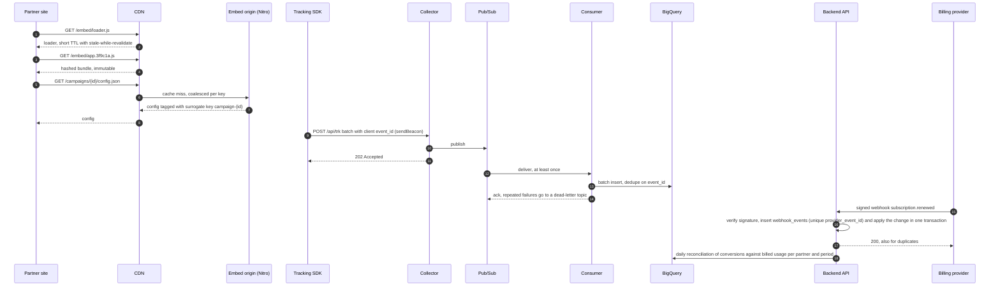

# Task report

Setup is in `README.md`, and the spec and the plan are in `docs/superpowers/`. Each model's raw reply is kept unchanged in git as a `chore(ai-raw)` commit.

## Task 1: Applicant summary API

The backend is Laravel 13 on PHP 8.4, with Doctrine ORM and spatie/laravel-data DTOs. `GET /api/v1/campaigns/{campaignId}/applicant-summary` returns the campaign summary and one page of applicants as JSON:API. `PATCH /api/v1/applicants/{applicantId}` sets an applicant's status for the card's buttons.

Auth is a mock bearer token, looked up by its SHA-256 hash; a missing or unknown token gets a 401. Route binding finds the campaign or applicant only among the partner's own records, so malformed, unknown and foreign IDs all get the same 404. Authentication runs before the lookup.

FormRequests validate and build typed DTOs: `min_score` is an integer from 0 to 100 (`80.5` is rejected, not truncated), `page[size]` 1 to 50 (default 10), `page[number]` at least 1, `status` one of the three statuses, `search` at most 100 characters. Every error is a JSON:API error object. Query errors name the parameter (`page[size]`), body errors carry a JSON pointer, and a 500 hides the exception.

The summary covers the whole campaign, while the filters narrow only the paged list. It takes four queries at any size: one aggregate, the top three scoring 90 or more, the page, and the filtered count. An empty campaign returns zeros. Unscored applicants count in the total but not the average and sort last. Equal scores order by application date, then ID. A page past the end skips the query, which also stops a huge `page[number]` from overflowing. The schema is one Doctrine migration on the DBAL 4.5 editors that runs on SQLite and MySQL. The frontend's TypeScript types are generated from the DTOs. There are 83 PHPUnit tests, and PHPStan level 8 and Pint are clean.

## Task 2: Applicant review card

The frontend is Nuxt 4, Tailwind CSS 4 and TypeScript. `ApplicantReviewCard.vue` shows one applicant, `ApplicantReviewBoard.vue` holds the filters, states and paging, and the `useApplicantReview` composable owns the data. That composable is all the page's state, so there is no Pinia store.

The card shows the name, a score badge coloured by tier with a screen reader label, the date in UTC and three highlights; View details adds the rest. Shortlist and Reject update the status pill at once, in a live region. A failure rolls the status back with an error message. The confirmed status goes to whichever row is on screen, so a filter change mid-request leaves no stale status. Both buttons are disabled while a request runs, and the one for the current status is pressed and disabled.

The board shows skeletons on the first load, then keeps the list in place under Nuxt's loading bar. It has empty, "Campaign not found." and Retry states. The score slider, status select and search box are debounced by 250 ms, reset to page 1 and ignore stale responses. At 0 the slider omits `min_score`, which would otherwise hide unscored applicants. Nuxt's server proxies only the page's two calls and adds the token, so the browser never sees it. There are 33 Vitest and 3 Playwright tests, and the typecheck and ESLint are clean.

## Task 3: AI tooling and workflow

### How the work ran

Everything was built in one Claude Code session. Claude Opus 5.5 ran it, and fresh Sonnet subagents wrote one-shot drafts. They were told not to touch files, and their transcripts show no tool calls besides returning the answer. I didn't use Cursor or Gemini.

The assignment became a spec over three review rounds; my corrections were Doctrine instead of Eloquent, and laravel-data with generated types. Before planning, the session ran every package in a throwaway app. That caught laravel-data caching through missing database tables (a 500 on every request), `migrations:diff` writing one database's SQL, an `int` rule accepting `80.5`, and PHP encoding `0.0` as `0`. Then came a 16-task, test-first plan. Each draft was committed unchanged (`chore(ai-raw)`), tested, then reworked in a separate commit. A fresh Opus review of the branch led to five more test-first fixes.

### Prompts

The session opened with a one-line request to plan the assignment, and I corrected the design twice in chat: Doctrine instead of Eloquent, and spatie/laravel-data for the DTOs with generated TypeScript types. Below is that opening request written out as the full brief it stood for, from the assignment's contents. I wrote it afterwards for this report; it was not sent. What the session actually worked from was the spec the brainstorming produced, in `docs/superpowers/specs/`.

```text
Build a small full-stack slice of a B2B platform that connects organisations with student applicants. Partners run campaigns, applicants apply, and an AI review gives each applicant a match score and a few evaluation highlights. Deliver one repository: backend/ (Laravel endpoint, service and tests), frontend/ (Nuxt component, TypeScript types and tests), and a README.md with the setup to run both apps and their tests locally. Write a spec first, then a plan, then implement test-first.

1. Backend: Laravel 13 on PHP 8.4, Doctrine ORM instead of Eloquent, spatie/laravel-data for every DTO.
- GET /api/v1/campaigns/{campaignId}/applicant-summary, handled by a controller and a service (or a repository or action).
- Check that campaignId is a valid identifier, and authorize the caller with a mock bearer token in middleware.
- Return the campaign's total applicants, eligible applicant count, average AI score, and the top-tier applicant highlights.
- Filter by minimum score (?min_score=80) and paginate (?page[size]=10&page[number]=1).
- Respond in JSON:API: data objects with attributes, a meta summary, and error objects on failure.
- PHPUnit feature and unit tests: a 200 with correct aggregates, an invalid ID giving 422 or 404, and a campaign with no applicants returning zeroed aggregates without dividing by zero.

2. Frontend: Nuxt 4, Vue 3 with <script setup lang="ts"> and the Composition API, Tailwind CSS, TypeScript.
- A reusable Applicant Review card that consumes the endpoint above.
- Show the candidate's name, a match score badge coloured by score threshold, the application date, and the AI evaluation highlights as bullet points.
- Shortlist and Reject buttons with optimistic updates or a visible state transition, and View Details.
- Loading skeletons, an empty state when no applicant matches the filter, and a slider or dropdown that filters by minimum score.
- At least one Vitest component test or Playwright smoke test that checks the applicant data renders and that moving the filter or clicking an action updates the DOM.
- TypeScript types generated from the backend DTOs, not written by hand.
```

These three prompts went to the drafting models, verbatim apart from the pasted files. Each asks for one bounded piece against a contract the tests already pinned, and they produced the raw code compared in the next section. The first one covers the service and its aggregation logic, the second scaffolds the Vue card, and the third writes the composable.

```text
I'm building a Laravel 13 API with Doctrine ORM 3 (laravel-doctrine/orm, attribute mapping) and spatie/laravel-data. Write two classes:

1. App\Repositories\ApplicantRepository, a Doctrine EntityRepository for the Applicant entity below.
2. App\Services\ApplicantSummaryService with a method
   summarize(Partner $partner, ApplicantSummaryQueryData $query, string $url): ApplicantSummaryDocumentData

It backs GET /api/v1/campaigns/{campaignId}/applicant-summary. The campaign must belong to the partner, otherwise throw a 404 with the message "Campaign not found.". The summary covers the whole campaign: totalApplicants, eligibleApplicants (aiScore >= the campaign's eligibilityThreshold), averageAiScore rounded to 1 decimal, and topTier (up to 3 applicants with aiScore >= 90, highest first). The data list is paginated with pageSize and pageNumber, filtered by minScore (aiScore >= minScore) when it is set, and ordered by aiScore descending. Fill meta.page and JSON:API links (self, first, prev, next, last) using page[number] and page[size] query params on $url.

Here are the entities, enums and DTOs: [15 files pasted]

Reply with the two PHP files only.
```

```text
Write a Nuxt 4 component components/ApplicantReviewCard.vue with <script setup lang="ts"> and Tailwind CSS 4 classes. No <style> block.

Props: applicant: ApplicantResourceData, pending: boolean, error: string | null. The types are in ~/types/api, pasted below. Emits: update-status with an ApplicantStatus.

Wrap the card in an <article> and put the candidate name in an <h3>. Show a match score badge with data-testid="score-badge", coloured by tier: top bg-emerald-100, eligible bg-blue-100, below bg-amber-100, unscored bg-gray-100 with the text "Not scored". Show the application date formatted like "Oct 1, 2026", and the first three AI highlights as bullet points. Show the status as "Pending review", "Shortlisted" or "Rejected" in an element with data-testid="status", and the error message when there is one. Add Shortlist and Reject buttons that emit update-status and are disabled while pending, and a "View details" button that reveals the email and all highlights.

[frontend/types/api.ts pasted]

Reply with the .vue file only.
```

```text
Write a Nuxt 4 composable composables/useApplicantReview.ts in TypeScript.

useApplicantReview(campaignId: string) loads GET /api/v1/campaigns/{campaignId}/applicant-summary (a JSON:API response; the types are pasted below) with the query params min_score, page[number] and page[size] (10 per page). It returns refs applicants, pageMeta, loading, loadError (boolean), minScore (number, from a 0 to 100 slider), page, pendingIds (a Set of applicant ids with a request in flight) and actionErrors (Record<string, string> by applicant id), plus the functions load() and setStatus(id, status).

When minScore changes, debounce 250 ms, go back to page 1 and reload. When page changes, reload. setStatus sends PATCH /api/v1/applicants/{id} with the body { data: { type: 'applicants', id, attributes: { status } } } and Content-Type application/vnd.api+json. It updates the applicant's status optimistically, and if the request fails it rolls back and sets actionErrors[id] to "Could not update the status. Try again.". The component calls load() in onMounted.

[frontend/types/api.ts pasted]

Reply with the .ts file only.
```

### Raw AI output against the final code

The full diffs are `git diff eae774e ba56bb6`, `git diff 0a27659 5afa5a8` and `git diff 4331e37 c6c8e4e`.

<table>
<tr><th>Raw AI output</th><th>Final</th></tr>
<tr>
<td>

```php
->orderBy('unscored', 'ASC')
->addOrderBy('a.aiScore', 'DESC')
->addOrderBy('a.id', 'ASC')
->setFirstResult(($pageNumber - 1) * $pageSize)
```

</td>
<td>

```php
->orderBy('unscoredLast', 'ASC')
->addOrderBy('a.aiScore', 'DESC')
->addOrderBy('a.appliedAt', 'ASC')
->addOrderBy('a.id', 'ASC')
->setFirstResult($offset)
```

</td>
</tr>
<tr>
<td>

```vue
<button type="button" :disabled="pending" ...>
```

</td>
<td>

```vue
<button type="button"
  :aria-pressed="attributes.status === 'shortlisted'"
  :disabled="pending || attributes.status === 'shortlisted'" ...>
```

</td>
</tr>
<tr>
<td>

```ts
const loading = ref(false)
query: { min_score: minScore.value, ... }
```

</td>
<td>

```ts
const loading = ref(true)
query: { ...(minScore.value > 0 ? { min_score: minScore.value } : {}), ... }
```

</td>
</tr>
</table>

### Defects the AI introduced

Against the tests, the summary draft passed 24 of 29, the card draft 4 of 11 and the composable draft 23 of 24. The defects:

- **Summary:** equal scores sorted by random UUID, a huge `page[number]` returned a 500, and an uppercase UUID returned a 404.
- **Card:** the score badge had no screen reader label, the current status's button stayed enabled, details repeated the highlights, and status changes were never announced.
- **Composable:** at slider 0 it sent `min_score=0`, hiding unscored applicants, and it started with `loading` false, so the first paint said "No applicants yet."

A failing test caught each one except the last, which code review found. The drafts did get SQL aggregates, NULL ordering, UTC dates and stale-response guards right unprompted.

The main session erred too. The proxy first forwarded any `/api/v1` call, until a security review flagged it. The README's curl lacked `-g`. The plan missed Vitest's module cache. My composable rework dropped the draft's re-find of the row before rollback, and the final review caught that along with the missing status pill. During change 5 some files landed in the wrong checkout, until a stack trace gave it away.

### Later changes

After the first version I asked for twelve more changes, from FormRequest validation and route binding to Docker, static analysis and a status filter with search. Each went the same way: a one-shot draft committed unchanged, then a rework with a failing test wherever the defect allowed one. The drafts' worst defects:

- **The route-binding draft began every file with a `// path` comment above `<?php`.** PHP sends that as output, so every file with a namespace was a fatal error and the suite couldn't run.
- **The same draft cast an array in the PATCH body's `data.id` to a string, so it returned a 500.** The rule now checks for a string first, with `bail`, and returns a 422.
- **The migration called `Schema::addTable()`, which doesn't exist, and named its own indexes.** With only the call fixed, the next `doctrine:migrations:diff` would have rebuilt every table. The final version uses the names Doctrine generates and was checked on SQLite and MySQL 8.
- **A missing-config guard told the browser which server settings were absent.** That was a small information leak; the browser now gets a generic 500 and the server log names the settings.
- **The Docker draft committed a fixed `APP_KEY` and built a 1.54 GB frontend image.** The key is now generated at each start, and a two-stage build brought the image to 230 MB.
- **The live-reload draft kept dependencies in named volumes that `docker compose up -V` never refreshes,** and OPcache held PHP edits back for up to 2 seconds. A marker file showed the first, a timing check the second.
- **PHPStan could not see Doctrine,** so it misread the custom repository and flagged a property only Doctrine reads. phpstan-doctrine fixed both. Separately, the new lint packages produced a lock file that `npm ci` rejected on Linux, which only the Docker build caught.

### Velocity

Every time here is a commit time from `git log`, local time on 12 October.

The design spec was committed at 17:10 and the plan at 17:40. The 17 execution commits ran from 17:50 to 18:14, 24 minutes. The fresh review's fixes were committed between 19:00 and 19:02 and merged at 19:03. So the first version took 1 hour 53 minutes from the first commit to that merge. The brainstorming before the first commit isn't in git.

| Piece | Tests committed | Raw draft | Rework | Tests to rework | By hand (estimate) |
|---|---|---|---|---|---|
| Summary repository and service | 17:52:56 | 17:55:47 | 17:56:40 | 3 min 44 s | about 2 hours |
| Review card | 18:00:41 | 18:05:34 | 18:06:12 | 5 min 31 s, including the Vitest cache fix | about 1 hour |
| Review composable | 18:08:10 | 18:09:39 | 18:10:29 | 2 min 19 s | about 1.5 hours |

Those minutes cover drafting and rework only, because the reference code was written into the plan before 17:40. The twelve later changes took 57 minutes from each change's first commit to its merge, between 1.5 and 11 minutes each. Git doesn't show the time before each first commit, which went on the drafting prompt and, for some, the investigation. By hand I'd put those twelve at 8 to 9 hours.

The scope goes past the brief's 3 to 4 hours: Doctrine, generated types, 83 backend and 36 frontend tests, the proxy allowlist and this report. By hand I'd put the first version alone at 10 to 12 hours. The by-hand figures are estimates; the git times are measured.

The workflow: spec first, libraries checked in a scratch project, tests before code, bounded units with every diff read, and generated contracts. The model turns a precise description into code fastest. Deciding what it says is still my job.

## Task 4: Embed and tracking incident

### Root cause

The embed server does heavy per-request work in one Node process and writes tracking events synchronously in that same process. The 50-key LRU cache, keyed by raw URL, misses on every UTM variant of a viral campaign. Each miss recompiles synchronously on the event loop, so everything waits: 120 ms becomes 4.5 s. The cap counts keys, not bytes, and a hot key's expiry sends every concurrent request into its own compile. The heap fills and the process misses health checks or is killed, so the load balancer returns 502s. `/api/trk` forwards to the warehouse inside the request. A slow warehouse holds memory, and a dying process loses events the SDK never retries and that carry no ID. Billing reads the relational database while conversions come from the warehouse, so lost events split the two.

### Mitigation within an hour

1. Put the CDN in front of the scripts (`s-maxage=300, stale-while-revalidate=86400`), with the version as the only query parameter in the key.
2. Strip the query from the cache key, cap the cache by bytes, and share one compile promise per key.
3. Add replicas, with `--max-old-space-size` below the container limit.
4. Log every event before forwarding it, so drops can be replayed.
5. Move `/api/trk` to its own deployment.
6. Hold the incident window's invoices as provisional until reconciliation runs.

### Architecture for 50x volume

Scripts are prebuilt, content-hashed and immutable on the CDN, behind a short-TTL loader, so a release is one loader update. Campaign config is edge-cached and purged by surrogate key. Nitro caches through `routeRules` on shared Redis. The SDK batches events with client UUIDv7 IDs over `sendBeacon` and retries with the same IDs. A collector validates, rate limits, publishes to Pub/Sub (or Redis Streams on the current stack) and returns 202. Consumers dedupe into BigQuery and scale apart from the embed servers, the queue absorbs bursts, and repeated failures go to a dead-letter topic. Billing webhooks are verified by signature and stored by provider event ID under a unique index, in the same transaction as the change. Duplicates return 200, stale events are ignored, and outgoing billing changes go through a transactional outbox. A daily job reconciles conversions with billed usage, and invoices finalize only after late events can no longer arrive. Dashboards read cached rollups, never raw events.

### Event flow


