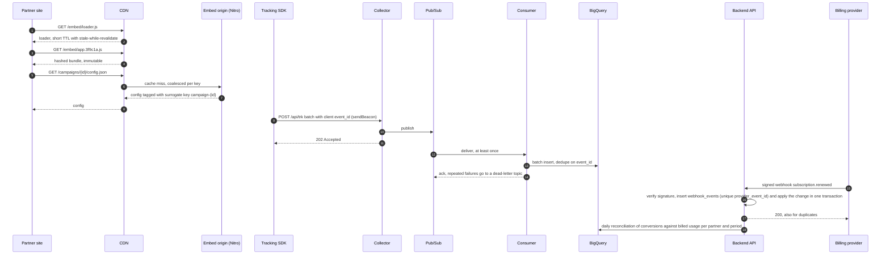

# B2B Full-Stack Practical Task Implementation Plan

> **For agentic workers:** REQUIRED SUB-SKILL: Use superpowers:subagent-driven-development (recommended) or superpowers:executing-plans to implement this plan task-by-task. Steps use checkbox (`- [ ]`) syntax for tracking.

**Goal:** Ship the assessment repo: a Laravel 13 + Doctrine JSON:API endpoint with PHPUnit tests, a Nuxt 4 applicant review card with Vitest and Playwright tests, and a `TASK_REPORT.md` covering all four tasks.

**Architecture:** `backend/` is an API-only Laravel 13 app. Doctrine ORM owns persistence, spatie/laravel-data owns every DTO, and spatie/laravel-typescript-transformer generates `frontend/types/api.ts` from those DTOs. `frontend/` is a Nuxt 4 app whose Nitro server proxies `/api/v1/**` to Laravel with the partner token, so the browser never sees it. Three pieces (summary repository and service, review card, review composable) are first drafted by a fresh AI agent from a one-shot prompt, committed raw, then refactored, which gives Task 3 real raw-vs-final diffs.

**Tech Stack:** PHP 8.4, Laravel 13.35, laravel-doctrine/orm 3.3 (Doctrine ORM 3.7, DBAL 4.5), laravel-doctrine/migrations 3.4, spatie/laravel-data 4.23, spatie/laravel-typescript-transformer 3.3, PHPUnit 12, SQLite. Node 22.23.1, Nuxt 4.6.1, Vue 3.5, Tailwind CSS 4.3, @nuxt/test-utils 4.3, Vitest 5, Playwright 1.64.

**Spec:** `docs/superpowers/specs/2026-10-12-b2b-fullstack-task-design.md`

## Global Constraints

- PHP `^8.4` in `backend/composer.json`. Doctrine uses PHP 8.4 native lazy objects; never generate proxies.
- Laravel 13 from `composer create-project laravel/laravel`. No Eloquent models, no FormRequests, no `exists` validation rules.
- `laravel-doctrine/orm:^3.3`, `laravel-doctrine/migrations:^3.4`, `spatie/laravel-data:^4.23`, `spatie/laravel-typescript-transformer:^3.3`. No other new Composer packages.
- Backend `.env` and `.env.example`: `SESSION_DRIVER=array`, `CACHE_STORE=file`, `QUEUE_CONNECTION=sync` (no Laravel tables exist; laravel-data caches through the cache store).
- Node 22.23.1 through nvm. Every frontend shell command runs after `source ~/.nvm/nvm.sh && nvm use` in `frontend/`.
- Frontend packages exactly as listed in Task 8. No PrimeVue, Pinia, lodash, VueUse or other additions.
- Every `/api` response, success or error, has `Content-Type: application/vnd.api+json`. Attribute names are camelCase.
- Frontend API types come only from the generated `frontend/types/api.ts`. Never edit it by hand; regenerate with `composer types` in `backend/`.
- No `<style>` blocks in `.vue` files. Tailwind utility classes only.
- Demo constants: token `demo-partner-token`; demo campaign `0b8f3c2e-5a61-4c7d-9e2a-3f4b5c6d7e81`; empty campaign `7d1e9a40-2b3c-4d5e-8f60-718293a4b5c6`.
- Business constants: top tier score 90, top tier limit 3, default eligibility threshold 70, `page[size]` default 10 and max 50, slider debounce 250 ms.
- Commits: Conventional Commits, no Asana IDs, each message ends with `Co-Authored-By: Claude Opus 5.5 (1M context) <noreply@anthropic.com>`. Stage explicit paths only; never `git add -A` or `git add .`. Never commit screenshots, recordings or scratch scripts.
- Git: no rebase, no force push, merge commits only. Nothing is pushed to `origin` until the user approves.
- Prose in `TASK_REPORT.md`, `README.md` and commit messages: no em or en dashes, no emojis, no arrow symbols in prose. Run the `humanizer:humanizer` skill on report and README text before committing it.

## Review Focus

1. A fast slider sends several requests; a slow early response must not overwrite the newer result. Pinned in Task 11 (`ignores a slow response from an older request`).
2. With the slider at 0 the frontend must omit `min_score`, otherwise every unscored applicant disappears (the API treats `min_score=0` as `aiScore >= 0`). Pinned in Task 11 (`omits min_score at 0`).
3. A huge `page[number]` such as `9000000000000000000` must return 200 with empty data, not a 500 from integer overflow in the offset. Pinned in Task 3 (`test_page_past_the_end_is_empty`).
4. Fractional or array query values (`min_score=80.5`, `page[size][]=5`) must be rejected with 422, not silently truncated. Pinned in Task 3 (`invalidQueries` data provider).
5. Partners paste campaign IDs; an uppercase UUID must find the same campaign. Pinned in Task 3 (`test_uppercase_campaign_id_finds_the_campaign`).

Also pinned: dates near midnight render in UTC (Task 8 card test), seeding twice does not crash (Task 7), an unauthenticated request with bad parameters gets 401 rather than leaking validation details (Task 3).

## Before you start

The repo has branch `docs/design` with the spec and this plan; `main` has no commits yet.

```bash
cd /Users/aleksey/www/b2b-fullstack-task-submission
git branch main docs/design
```

Then set up an isolated worktree with the `superpowers:using-git-worktrees` skill: new branch `feat/submission` from `main`. All tasks run inside that worktree; paths below are relative to its root. `docs/design` is deleted after the final merge in Task 16.

## File map

```
.gitignore                                   root ignores (OS, IDE, recordings)
backend/
  composer.json                              php ^8.4, "types" script
  .env.example, phpunit.xml                  drivers, test env
  bootstrap/app.php                          api routes, middleware, exception renderer
  bootstrap/providers.php                    + TypeScriptTransformerServiceProvider
  config/doctrine.php, config/migrations.php published package config
  routes/api.php                             v1 routes behind `partner`
  app/Enums/ApplicantStatus.php              pending | shortlisted | rejected
  app/Enums/ScoreTier.php                    tier rules and constants
  app/Entities/{Partner,Campaign,Applicant}.php
  app/Repositories/ApplicantRepository.php   all applicant queries
  app/Services/ApplicantSummaryService.php   summary document assembly
  app/Data/*.php                             output DTOs (TypeScript source)
  app/Http/Input/*.php                       input DTOs (validated request data)
  app/Http/JsonApiExceptionRenderer.php      every /api error as JSON:API
  app/Http/Middleware/{AuthenticatePartner,JsonApiContentType}.php
  app/Http/Controllers/Api/V1/{ApplicantSummaryController,UpdateApplicantStatusController}.php
  app/Providers/TypeScriptTransformerServiceProvider.php
  database/migrations/Version20261012000000.php
  database/seeders/DatabaseSeeder.php
  tests/Concerns/{RefreshesDoctrineSchema,CreatesEntities}.php
  tests/Unit/{ScoreTierTest,ApplicantSummaryDataTest}.php
  tests/Feature/{DoctrineMappingTest,JsonApiErrorsTest,ApplicantSummaryTest,UpdateApplicantStatusTest,DatabaseSeederTest}.php
frontend/
  .nvmrc, package.json, nuxt.config.ts, tsconfig.json, vitest.config.ts, playwright.config.ts, .gitignore
  app.vue, assets/css/main.css
  types/api.ts                               generated, do not edit
  server/api/v1/[...path].ts                 proxy to Laravel
  composables/useApplicantReview.ts          fetch, filter, paging, optimistic status
  components/ApplicantReviewCard.vue         one applicant
  components/ApplicantReviewBoard.vue        filter, states, list, paging
  pages/index.vue, pages/campaigns/[id].vue
  tests/nuxt/fixtures.ts, tests/nuxt/ApplicantReviewCard.spec.ts, tests/nuxt/ApplicantReviewBoard.spec.ts
  tests/e2e/smoke.spec.ts
README.md
TASK_REPORT.md
```

---

### Task 1: Backend foundation (Laravel, Doctrine, entities, schema)

**Files:**
- Create: `.gitignore`, `backend/` (skeleton), `backend/app/Enums/ApplicantStatus.php`, `backend/app/Enums/ScoreTier.php`, `backend/app/Entities/Partner.php`, `backend/app/Entities/Campaign.php`, `backend/app/Entities/Applicant.php`, `backend/app/Repositories/ApplicantRepository.php`, `backend/database/migrations/Version20261012000000.php`, `backend/tests/Concerns/RefreshesDoctrineSchema.php`, `backend/tests/Concerns/CreatesEntities.php`
- Modify: `backend/composer.json`, `backend/.env.example`
- Delete: `backend/app/Models/User.php`, `backend/database/factories/UserFactory.php`, `backend/database/migrations/0001_01_01_00000*.php`, `backend/tests/Feature/ExampleTest.php`, `backend/tests/Unit/ExampleTest.php`
- Test: `backend/tests/Unit/ScoreTierTest.php`, `backend/tests/Feature/DoctrineMappingTest.php`

**Interfaces:**
- Produces:
  - `App\Enums\ApplicantStatus`: string enum, cases `Pending='pending'`, `Shortlisted='shortlisted'`, `Rejected='rejected'`.
  - `App\Enums\ScoreTier`: string enum, cases `Top`, `Eligible`, `Below`, `Unscored`; consts `TOP_SCORE = 90`, `TOP_LIMIT = 3`; `static for(?int $score, int $eligibilityThreshold): self`.
  - `App\Entities\Partner(string $name, string $apiTokenHash)`: `getId(): string`, `getName(): string`.
  - `App\Entities\Campaign(Partner $partner, string $name, int $eligibilityThreshold = 70, ?string $id = null)`: `getId()`, `getPartner(): Partner`, `getName()`, `getEligibilityThreshold(): int`.
  - `App\Entities\Applicant(Campaign $campaign, string $fullName, string $email, ?int $aiScore, array $highlights, DateTimeImmutable $appliedAt)`: `getId()`, `getCampaign()`, `getFullName()`, `getEmail()`, `getAiScore(): ?int`, `getHighlights(): array`, `getStatus(): ApplicantStatus`, `setStatus(ApplicantStatus)`, `getAppliedAt(): DateTimeImmutable`.
  - `App\Repositories\ApplicantRepository`: empty `EntityRepository` subclass (filled in Tasks 5 and 6).
  - Test traits: `RefreshesDoctrineSchema` gives `protected EntityManagerInterface $em` and a fresh schema per test; `CreatesEntities` gives `makePartner(string $token = 'partner-token', string $name = 'Acme University'): Partner`, `makeCampaign(Partner $partner, int $eligibilityThreshold = 70, string $name = 'Autumn intake'): Campaign`, `makeApplicant(Campaign $campaign, ?int $aiScore = 80, string $name = 'Applicant', string $appliedAt = '2026-10-01 09:00:00', array $highlights = ['Strong maths portfolio'], ApplicantStatus $status = ApplicantStatus::Pending): Applicant` (email is the name slugged with dots plus `@example.com`).

- [ ] **Step 1: Scaffold Laravel and install packages**

```bash
composer create-project laravel/laravel backend --no-interaction --prefer-dist
cd backend
composer require -W --no-interaction laravel-doctrine/orm:^3.3 laravel-doctrine/migrations:^3.4 spatie/laravel-data:^4.23 spatie/laravel-typescript-transformer:^3.3
php artisan vendor:publish --provider="LaravelDoctrine\ORM\DoctrineServiceProvider" --tag=config
php artisan vendor:publish --provider="LaravelDoctrine\Migrations\MigrationsServiceProvider"
rm app/Models/User.php database/factories/UserFactory.php database/migrations/0001_01_01_00000*.php tests/Feature/ExampleTest.php tests/Unit/ExampleTest.php
rmdir app/Models database/factories
rm -f database/database.sqlite && touch database/database.sqlite
sed -i '' 's/"php": "^8.3"/"php": "^8.4"/' composer.json
composer config scripts.types "@php artisan typescript:transform"
for f in .env .env.example; do sed -i '' -e 's/^SESSION_DRIVER=.*/SESSION_DRIVER=array/' -e 's/^CACHE_STORE=.*/CACHE_STORE=file/' -e 's/^QUEUE_CONNECTION=.*/QUEUE_CONNECTION=sync/' "$f"; done
composer update --lock --no-interaction
```

Expected: `config/doctrine.php` and `config/migrations.php` exist; `grep -E '^(SESSION_DRIVER|CACHE_STORE|QUEUE_CONNECTION)' .env.example` prints `array`, `file`, `sync`.

Create the root `.gitignore`:

```gitignore
.DS_Store
.idea/
.worktrees/
*.mp4
*.webm
*.gif
```

- [ ] **Step 2: Write the failing tests**

`backend/tests/Unit/ScoreTierTest.php`:

```php
<?php

namespace Tests\Unit;

use App\Enums\ScoreTier;
use PHPUnit\Framework\Attributes\DataProvider;
use PHPUnit\Framework\TestCase;

class ScoreTierTest extends TestCase
{
    public static function scores(): array
    {
        return [
            'not scored' => [null, 70, ScoreTier::Unscored],
            'top boundary' => [90, 70, ScoreTier::Top],
            'perfect score' => [100, 70, ScoreTier::Top],
            'just below top' => [89, 70, ScoreTier::Eligible],
            'at the threshold' => [70, 70, ScoreTier::Eligible],
            'just below the threshold' => [69, 70, ScoreTier::Below],
            'zero' => [0, 70, ScoreTier::Below],
            'top wins over a higher threshold' => [92, 95, ScoreTier::Top],
        ];
    }

    #[DataProvider('scores')]
    public function test_tier_for_score(?int $score, int $threshold, ScoreTier $expected): void
    {
        $this->assertSame($expected, ScoreTier::for($score, $threshold));
    }
}
```

`backend/tests/Feature/DoctrineMappingTest.php`:

```php
<?php

namespace Tests\Feature;

use App\Entities\Applicant;
use App\Enums\ApplicantStatus;
use Doctrine\ORM\Tools\SchemaValidator;
use Tests\Concerns\CreatesEntities;
use Tests\Concerns\RefreshesDoctrineSchema;
use Tests\TestCase;

class DoctrineMappingTest extends TestCase
{
    use RefreshesDoctrineSchema, CreatesEntities;

    public function test_mapping_is_valid(): void
    {
        $this->assertSame([], (new SchemaValidator($this->em))->validateMapping());
    }

    public function test_applicant_round_trips_through_the_database(): void
    {
        $campaign = $this->makeCampaign($this->makePartner());
        $applicant = $this->makeApplicant($campaign, 88, 'Ada Lovelace', '2026-10-01 09:30:00', ['Strong maths portfolio', 'Led a robotics club']);
        $id = $applicant->getId();
        $this->em->clear();

        $reloaded = $this->em->find(Applicant::class, $id);

        $this->assertSame('Ada Lovelace', $reloaded->getFullName());
        $this->assertSame('ada.lovelace@example.com', $reloaded->getEmail());
        $this->assertSame(88, $reloaded->getAiScore());
        $this->assertSame(['Strong maths portfolio', 'Led a robotics club'], $reloaded->getHighlights());
        $this->assertSame(ApplicantStatus::Pending, $reloaded->getStatus());
        $this->assertSame('2026-10-01T09:30:00+00:00', $reloaded->getAppliedAt()->format(DATE_ATOM));
        $this->assertSame($campaign->getId(), $reloaded->getCampaign()->getId());
        $this->assertSame(70, $reloaded->getCampaign()->getEligibilityThreshold());
    }

    public function test_unscored_applicant_keeps_a_null_score(): void
    {
        $id = $this->makeApplicant($this->makeCampaign($this->makePartner()), null)->getId();
        $this->em->clear();

        $this->assertNull($this->em->find(Applicant::class, $id)->getAiScore());
    }
}
```

- [ ] **Step 3: Run the tests to see them fail**

Run: `php artisan test`
Expected: FAIL, `Class "App\Enums\ScoreTier" not found` and `Trait "Tests\Concerns\RefreshesDoctrineSchema" not found`.

- [ ] **Step 4: Write the enums, entities, repository and test traits**

`backend/app/Enums/ApplicantStatus.php`:

```php
<?php

namespace App\Enums;

enum ApplicantStatus: string
{
    case Pending = 'pending';
    case Shortlisted = 'shortlisted';
    case Rejected = 'rejected';
}
```

`backend/app/Enums/ScoreTier.php`:

```php
<?php

namespace App\Enums;

enum ScoreTier: string
{
    case Top = 'top';
    case Eligible = 'eligible';
    case Below = 'below';
    case Unscored = 'unscored';

    public const TOP_SCORE = 90;

    public const TOP_LIMIT = 3;

    public static function for(?int $score, int $eligibilityThreshold): self
    {
        return match (true) {
            $score === null => self::Unscored,
            $score >= self::TOP_SCORE => self::Top,
            $score >= $eligibilityThreshold => self::Eligible,
            default => self::Below,
        };
    }
}
```

`backend/app/Entities/Partner.php`:

```php
<?php

namespace App\Entities;

use Doctrine\ORM\Mapping as ORM;
use Illuminate\Support\Str;

#[ORM\Entity]
#[ORM\Table(name: 'partners')]
class Partner
{
    #[ORM\Id]
    #[ORM\Column(type: 'guid')]
    private string $id;

    public function __construct(
        #[ORM\Column]
        private string $name,
        #[ORM\Column(length: 64, unique: true)]
        private string $apiTokenHash,
    ) {
        $this->id = (string) Str::uuid();
    }

    public function getId(): string
    {
        return $this->id;
    }

    public function getName(): string
    {
        return $this->name;
    }
}
```

`backend/app/Entities/Campaign.php`:

```php
<?php

namespace App\Entities;

use Doctrine\ORM\Mapping as ORM;
use Illuminate\Support\Str;

#[ORM\Entity]
#[ORM\Table(name: 'campaigns')]
class Campaign
{
    #[ORM\Id]
    #[ORM\Column(type: 'guid')]
    private string $id;

    public function __construct(
        #[ORM\ManyToOne(targetEntity: Partner::class)]
        #[ORM\JoinColumn(nullable: false)]
        private Partner $partner,
        #[ORM\Column]
        private string $name,
        #[ORM\Column(type: 'smallint', options: ['default' => 70])]
        private int $eligibilityThreshold = 70,
        ?string $id = null,
    ) {
        $this->id = $id ?? (string) Str::uuid();
    }

    public function getId(): string
    {
        return $this->id;
    }

    public function getPartner(): Partner
    {
        return $this->partner;
    }

    public function getName(): string
    {
        return $this->name;
    }

    public function getEligibilityThreshold(): int
    {
        return $this->eligibilityThreshold;
    }
}
```

`backend/app/Entities/Applicant.php`:

```php
<?php

namespace App\Entities;

use App\Enums\ApplicantStatus;
use App\Repositories\ApplicantRepository;
use DateTimeImmutable;
use Doctrine\ORM\Mapping as ORM;
use Illuminate\Support\Str;

#[ORM\Entity(repositoryClass: ApplicantRepository::class)]
#[ORM\Table(name: 'applicants')]
#[ORM\Index(name: 'applicants_campaign_score_idx', columns: ['campaign_id', 'ai_score'])]
class Applicant
{
    #[ORM\Id]
    #[ORM\Column(type: 'guid')]
    private string $id;

    #[ORM\Column(length: 20, enumType: ApplicantStatus::class)]
    private ApplicantStatus $status = ApplicantStatus::Pending;

    /**
     * @param list<string> $highlights
     */
    public function __construct(
        #[ORM\ManyToOne(targetEntity: Campaign::class)]
        #[ORM\JoinColumn(nullable: false)]
        private Campaign $campaign,
        #[ORM\Column]
        private string $fullName,
        #[ORM\Column]
        private string $email,
        #[ORM\Column(type: 'smallint', nullable: true)]
        private ?int $aiScore,
        #[ORM\Column(type: 'json')]
        private array $highlights,
        #[ORM\Column(type: 'datetime_immutable')]
        private DateTimeImmutable $appliedAt,
    ) {
        $this->id = (string) Str::uuid();
    }

    public function getId(): string
    {
        return $this->id;
    }

    public function getCampaign(): Campaign
    {
        return $this->campaign;
    }

    public function getFullName(): string
    {
        return $this->fullName;
    }

    public function getEmail(): string
    {
        return $this->email;
    }

    public function getAiScore(): ?int
    {
        return $this->aiScore;
    }

    /**
     * @return list<string>
     */
    public function getHighlights(): array
    {
        return $this->highlights;
    }

    public function getStatus(): ApplicantStatus
    {
        return $this->status;
    }

    public function setStatus(ApplicantStatus $status): void
    {
        $this->status = $status;
    }

    public function getAppliedAt(): DateTimeImmutable
    {
        return $this->appliedAt;
    }
}
```

`backend/app/Repositories/ApplicantRepository.php`:

```php
<?php

namespace App\Repositories;

use App\Entities\Applicant;
use Doctrine\ORM\EntityRepository;

/**
 * @extends EntityRepository<Applicant>
 */
class ApplicantRepository extends EntityRepository
{
}
```

`backend/tests/Concerns/RefreshesDoctrineSchema.php`:

```php
<?php

namespace Tests\Concerns;

use Doctrine\ORM\EntityManagerInterface;
use Doctrine\ORM\Tools\SchemaTool;

trait RefreshesDoctrineSchema
{
    protected EntityManagerInterface $em;

    // Each test boots a new app with a new in-memory SQLite connection, so creating the schema is enough.
    protected function setUpRefreshesDoctrineSchema(): void
    {
        $this->em = $this->app->make(EntityManagerInterface::class);
        (new SchemaTool($this->em))->createSchema($this->em->getMetadataFactory()->getAllMetadata());
    }
}
```

`backend/tests/Concerns/CreatesEntities.php`:

```php
<?php

namespace Tests\Concerns;

use App\Entities\Applicant;
use App\Entities\Campaign;
use App\Entities\Partner;
use App\Enums\ApplicantStatus;
use DateTimeImmutable;
use DateTimeZone;
use Illuminate\Support\Str;

trait CreatesEntities
{
    protected function makePartner(string $token = 'partner-token', string $name = 'Acme University'): Partner
    {
        $partner = new Partner($name, hash('sha256', $token));
        $this->em->persist($partner);
        $this->em->flush();

        return $partner;
    }

    protected function makeCampaign(Partner $partner, int $eligibilityThreshold = 70, string $name = 'Autumn intake'): Campaign
    {
        $campaign = new Campaign($partner, $name, $eligibilityThreshold);
        $this->em->persist($campaign);
        $this->em->flush();

        return $campaign;
    }

    /**
     * @param list<string> $highlights
     */
    protected function makeApplicant(
        Campaign $campaign,
        ?int $aiScore = 80,
        string $name = 'Applicant',
        string $appliedAt = '2026-10-01 09:00:00',
        array $highlights = ['Strong maths portfolio'],
        ApplicantStatus $status = ApplicantStatus::Pending,
    ): Applicant {
        $applicant = new Applicant(
            $campaign,
            $name,
            Str::slug($name, '.').'@example.com',
            $aiScore,
            $highlights,
            new DateTimeImmutable($appliedAt, new DateTimeZone('UTC')),
        );
        $applicant->setStatus($status);
        $this->em->persist($applicant);
        $this->em->flush();

        return $applicant;
    }
}
```

- [ ] **Step 5: Write the migration**

`backend/database/migrations/Version20261012000000.php` (DBAL schema API, so it runs on SQLite and MySQL):

```php
<?php

declare(strict_types=1);

namespace Database\Migrations;

use Doctrine\DBAL\Schema\Schema;
use Doctrine\Migrations\AbstractMigration;

final class Version20261012000000 extends AbstractMigration
{
    public function getDescription(): string
    {
        return 'Partners, campaigns and applicants';
    }

    public function up(Schema $schema): void
    {
        $partners = $schema->createTable('partners');
        $partners->addColumn('id', 'guid');
        $partners->addColumn('name', 'string', ['length' => 255]);
        $partners->addColumn('api_token_hash', 'string', ['length' => 64]);
        $partners->setPrimaryKey(['id']);
        $partners->addUniqueIndex(['api_token_hash']);

        $campaigns = $schema->createTable('campaigns');
        $campaigns->addColumn('id', 'guid');
        $campaigns->addColumn('partner_id', 'guid');
        $campaigns->addColumn('name', 'string', ['length' => 255]);
        $campaigns->addColumn('eligibility_threshold', 'smallint', ['default' => 70]);
        $campaigns->setPrimaryKey(['id']);
        $campaigns->addIndex(['partner_id']);
        $campaigns->addForeignKeyConstraint('partners', ['partner_id'], ['id']);

        $applicants = $schema->createTable('applicants');
        $applicants->addColumn('id', 'guid');
        $applicants->addColumn('campaign_id', 'guid');
        $applicants->addColumn('full_name', 'string', ['length' => 255]);
        $applicants->addColumn('email', 'string', ['length' => 255]);
        $applicants->addColumn('ai_score', 'smallint', ['notnull' => false]);
        $applicants->addColumn('highlights', 'json');
        $applicants->addColumn('status', 'string', ['length' => 20]);
        $applicants->addColumn('applied_at', 'datetime_immutable');
        $applicants->setPrimaryKey(['id']);
        $applicants->addIndex(['campaign_id']);
        $applicants->addIndex(['campaign_id', 'ai_score'], 'applicants_campaign_score_idx');
        $applicants->addForeignKeyConstraint('campaigns', ['campaign_id'], ['id']);
    }

    public function down(Schema $schema): void
    {
        $schema->dropTable('applicants');
        $schema->dropTable('campaigns');
        $schema->dropTable('partners');
    }
}
```

- [ ] **Step 6: Run the tests and check the migration against the mapping**

Run: `php artisan test`
Expected: PASS, 11 tests (8 tier cases, 3 mapping tests).

Run:
```bash
php artisan doctrine:migrations:migrate --no-interaction
php artisan doctrine:migrations:diff
```
Expected: `Successfully migrated to version: Database\Migrations\Version20261012000000`, then `No changes detected in your mapping information.` If `diff` generated a file, the migration and the mapping disagree: delete the generated file and fix the migration.

- [ ] **Step 7: Commit**

```bash
cd ..
git add .gitignore backend
git status --short | grep -E 'vendor/|\.env$|database\.sqlite' && echo "STOP: ignored files staged"
git commit -m "feat(backend): scaffold Laravel 13 with Doctrine entities and schema

Co-Authored-By: Claude Opus 5.5 (1M context) <noreply@anthropic.com>"
```

---

### Task 2: JSON:API errors, content type and partner auth

**Files:**
- Create: `backend/app/Data/JsonApiErrorData.php`, `backend/app/Data/JsonApiErrorDocumentData.php`, `backend/app/Http/JsonApiExceptionRenderer.php`, `backend/app/Http/Middleware/AuthenticatePartner.php`, `backend/app/Http/Middleware/JsonApiContentType.php`, `backend/routes/api.php`
- Modify: `backend/bootstrap/app.php`
- Test: `backend/tests/Feature/JsonApiErrorsTest.php`

**Interfaces:**
- Consumes: `Partner`, `CreatesEntities::makePartner`, `RefreshesDoctrineSchema` (Task 1).
- Produces:
  - Route middleware alias `partner`: on success the request carries the partner at `$request->attributes->get('partner')` (a `Partner`); otherwise `AuthenticationException`.
  - `api` middleware group appends `JsonApiContentType`.
  - `routes/api.php` with a `Route::prefix('v1')->middleware('partner')` group that later tasks add routes to.
  - Error mapping: validation keys `campaignId`/`applicantId` -> `code: invalid_identifier`; keys starting `data.` -> `source.pointer` (`data.attributes.status` -> `/data/attributes/status`); any other key -> `source.parameter` in bracket form (`page.size` -> `page[size]`).
  - `App\Data\JsonApiErrorData(string $status, string $title, string|Optional $detail, string|Optional $code, array|Optional $source)` and `JsonApiErrorDocumentData(array $errors)`.

- [ ] **Step 1: Write the failing test**

`backend/tests/Feature/JsonApiErrorsTest.php`:

```php
<?php

namespace Tests\Feature;

use Illuminate\Support\Facades\Route;
use Illuminate\Validation\ValidationException;
use RuntimeException;
use Tests\Concerns\CreatesEntities;
use Tests\Concerns\RefreshesDoctrineSchema;
use Tests\TestCase;

class JsonApiErrorsTest extends TestCase
{
    use RefreshesDoctrineSchema, CreatesEntities;

    protected function setUp(): void
    {
        parent::setUp();

        Route::middleware(['api', 'partner'])->prefix('api/v1/_test')->group(function (): void {
            Route::get('ok', fn () => ['ok' => true]);
            Route::get('missing', fn () => abort(404, 'Campaign not found.'));
            Route::get('boom', fn () => throw new RuntimeException('database password is hunter2'));
            Route::get('invalid', fn () => throw ValidationException::withMessages([
                'campaignId' => ['The campaign id field must be a valid UUID.'],
                'page.size' => ['The page[size] field must be between 1 and 50.'],
                'min_score' => ['The min score field must be an integer.'],
                'data.attributes.status' => ['The selected status is invalid.'],
            ]));
        });
    }

    public function test_missing_token_is_a_json_api_401(): void
    {
        $this->getJson('/api/v1/_test/ok')
            ->assertUnauthorized()
            ->assertHeader('Content-Type', 'application/vnd.api+json')
            ->assertHeader('WWW-Authenticate', 'Bearer')
            ->assertExactJson(['errors' => [[
                'status' => '401',
                'title' => 'Unauthenticated',
                'detail' => 'A valid bearer token is required.',
            ]]]);
    }

    public function test_unknown_token_is_a_401(): void
    {
        $this->makePartner('right-token');

        $this->withToken('wrong-token')->getJson('/api/v1/_test/ok')->assertUnauthorized();
    }

    public function test_valid_token_passes_and_success_uses_the_json_api_content_type(): void
    {
        $this->makePartner('right-token');

        $this->withToken('right-token')->getJson('/api/v1/_test/ok')
            ->assertOk()
            ->assertHeader('Content-Type', 'application/vnd.api+json')
            ->assertExactJson(['ok' => true]);
    }

    public function test_http_exception_keeps_its_status_and_message(): void
    {
        $this->makePartner('right-token');

        $this->withToken('right-token')->getJson('/api/v1/_test/missing')
            ->assertNotFound()
            ->assertExactJson(['errors' => [['status' => '404', 'title' => 'Not Found', 'detail' => 'Campaign not found.']]]);
    }

    public function test_unknown_api_route_is_a_json_api_404(): void
    {
        $this->getJson('/api/v1/does-not-exist')
            ->assertNotFound()
            ->assertHeader('Content-Type', 'application/vnd.api+json')
            ->assertJsonPath('errors.0.status', '404');
    }

    public function test_unexpected_exception_hides_its_details(): void
    {
        $this->makePartner('right-token');

        $response = $this->withToken('right-token')->getJson('/api/v1/_test/boom');

        $response->assertStatus(500)->assertExactJson(['errors' => [['status' => '500', 'title' => 'Server Error']]]);
        $this->assertStringNotContainsString('hunter2', $response->getContent());
    }

    public function test_validation_errors_map_to_identifiers_parameters_and_pointers(): void
    {
        $this->makePartner('right-token');

        $this->withToken('right-token')->getJson('/api/v1/_test/invalid')
            ->assertUnprocessable()
            ->assertHeader('Content-Type', 'application/vnd.api+json')
            ->assertExactJson(['errors' => [
                ['status' => '422', 'title' => 'Invalid identifier', 'detail' => 'The campaign id field must be a valid UUID.', 'code' => 'invalid_identifier'],
                ['status' => '422', 'title' => 'Invalid parameter', 'detail' => 'The page[size] field must be between 1 and 50.', 'source' => ['parameter' => 'page[size]']],
                ['status' => '422', 'title' => 'Invalid parameter', 'detail' => 'The min score field must be an integer.', 'source' => ['parameter' => 'min_score']],
                ['status' => '422', 'title' => 'Invalid attribute', 'detail' => 'The selected status is invalid.', 'source' => ['pointer' => '/data/attributes/status']],
            ]]);
    }
}
```

- [ ] **Step 2: Run it to see it fail**

Run: `php artisan test --filter=JsonApiErrorsTest`
Expected: FAIL, `Target class [partner] does not exist` (the alias is not registered yet).

- [ ] **Step 3: Implement**

`backend/app/Data/JsonApiErrorData.php`:

```php
<?php

namespace App\Data;

use Spatie\LaravelData\Data;
use Spatie\LaravelData\Optional;

class JsonApiErrorData extends Data
{
    /**
     * @param array{parameter?: string, pointer?: string}|Optional $source
     */
    public function __construct(
        public string $status,
        public string $title,
        public string|Optional $detail = new Optional(),
        public string|Optional $code = new Optional(),
        public array|Optional $source = new Optional(),
    ) {}
}
```

`backend/app/Data/JsonApiErrorDocumentData.php`:

```php
<?php

namespace App\Data;

use Spatie\LaravelData\Data;

class JsonApiErrorDocumentData extends Data
{
    /**
     * @param list<JsonApiErrorData> $errors
     */
    public function __construct(
        public array $errors,
    ) {}
}
```

`backend/app/Http/JsonApiExceptionRenderer.php`:

```php
<?php

namespace App\Http;

use App\Data\JsonApiErrorData;
use App\Data\JsonApiErrorDocumentData;
use Illuminate\Auth\AuthenticationException;
use Illuminate\Http\JsonResponse;
use Illuminate\Http\Request;
use Illuminate\Validation\ValidationException;
use Spatie\LaravelData\Optional;
use Symfony\Component\HttpFoundation\Response;
use Symfony\Component\HttpKernel\Exception\HttpExceptionInterface;
use Throwable;

class JsonApiExceptionRenderer
{
    private const ROUTE_IDENTIFIERS = ['campaignId', 'applicantId'];

    public function __invoke(Throwable $e, Request $request): ?JsonResponse
    {
        if (! $request->is('api/*')) {
            return null;
        }

        [$status, $errors, $headers] = match (true) {
            $e instanceof ValidationException => [422, $this->validationErrors($e), []],
            $e instanceof AuthenticationException => [
                401,
                [new JsonApiErrorData('401', 'Unauthenticated', 'A valid bearer token is required.')],
                ['WWW-Authenticate' => 'Bearer'],
            ],
            $e instanceof HttpExceptionInterface => [$e->getStatusCode(), [$this->httpError($e)], $e->getHeaders()],
            default => [500, [new JsonApiErrorData('500', 'Server Error')], []],
        };

        return new JsonResponse(
            (new JsonApiErrorDocumentData($errors))->toArray(),
            $status,
            ['Content-Type' => 'application/vnd.api+json'] + $headers,
        );
    }

    private function httpError(HttpExceptionInterface $e): JsonApiErrorData
    {
        $status = $e->getStatusCode();

        return new JsonApiErrorData(
            status: (string) $status,
            title: Response::$statusTexts[$status] ?? 'Error',
            detail: $e->getMessage() !== '' ? $e->getMessage() : new Optional(),
        );
    }

    /**
     * @return list<JsonApiErrorData>
     */
    private function validationErrors(ValidationException $e): array
    {
        $errors = [];

        foreach ($e->errors() as $key => $messages) {
            foreach ($messages as $message) {
                $errors[] = match (true) {
                    in_array($key, self::ROUTE_IDENTIFIERS, true) => new JsonApiErrorData('422', 'Invalid identifier', $message, code: 'invalid_identifier'),
                    str_starts_with($key, 'data.') => new JsonApiErrorData('422', 'Invalid attribute', $message, source: ['pointer' => '/'.str_replace('.', '/', $key)]),
                    default => new JsonApiErrorData('422', 'Invalid parameter', $message, source: ['parameter' => preg_replace('/\.([^.]+)/', '[$1]', $key)]),
                };
            }
        }

        return $errors;
    }
}
```

`backend/app/Http/Middleware/AuthenticatePartner.php`:

```php
<?php

namespace App\Http\Middleware;

use App\Entities\Partner;
use Closure;
use Doctrine\ORM\EntityManagerInterface;
use Illuminate\Auth\AuthenticationException;
use Illuminate\Http\Request;
use Symfony\Component\HttpFoundation\Response;

class AuthenticatePartner
{
    public function __construct(private EntityManagerInterface $em) {}

    public function handle(Request $request, Closure $next): Response
    {
        $token = $request->bearerToken();
        $partner = $token === null
            ? null
            : $this->em->getRepository(Partner::class)->findOneBy(['apiTokenHash' => hash('sha256', $token)]);

        if ($partner === null) {
            throw new AuthenticationException();
        }

        $request->attributes->set('partner', $partner);

        return $next($request);
    }
}
```

`backend/app/Http/Middleware/JsonApiContentType.php`:

```php
<?php

namespace App\Http\Middleware;

use Closure;
use Illuminate\Http\Request;
use Symfony\Component\HttpFoundation\Response;

class JsonApiContentType
{
    public function handle(Request $request, Closure $next): Response
    {
        $response = $next($request);
        $response->headers->set('Content-Type', 'application/vnd.api+json');

        return $response;
    }
}
```

`backend/routes/api.php`:

```php
<?php

use Illuminate\Support\Facades\Route;

Route::prefix('v1')->middleware('partner')->group(function (): void {
});
```

Replace `backend/bootstrap/app.php` with:

```php
<?php

use App\Http\JsonApiExceptionRenderer;
use App\Http\Middleware\AuthenticatePartner;
use App\Http\Middleware\JsonApiContentType;
use Illuminate\Foundation\Application;
use Illuminate\Foundation\Configuration\Exceptions;
use Illuminate\Foundation\Configuration\Middleware;

return Application::configure(basePath: dirname(__DIR__))
    ->withRouting(
        web: __DIR__.'/../routes/web.php',
        api: __DIR__.'/../routes/api.php',
        commands: __DIR__.'/../routes/console.php',
        health: '/up',
    )
    ->withMiddleware(function (Middleware $middleware): void {
        $middleware->api(append: [JsonApiContentType::class]);
        $middleware->alias(['partner' => AuthenticatePartner::class]);
    })
    ->withExceptions(function (Exceptions $exceptions): void {
        $exceptions->render(new JsonApiExceptionRenderer());
    })->create();
```

- [ ] **Step 4: Run the tests**

Run: `php artisan test`
Expected: PASS, 18 tests.

- [ ] **Step 5: Commit**

```bash
git add backend/app/Data backend/app/Http backend/routes/api.php backend/bootstrap/app.php backend/tests/Feature/JsonApiErrorsTest.php
git commit -m "feat(api): JSON:API errors, content type and bearer token partner auth

Co-Authored-By: Claude Opus 5.5 (1M context) <noreply@anthropic.com>"
```

---

### Task 3: Applicant summary contract, controller and tests (red)

This task fixes the contract and the tests; the repository and service come from the raw AI draft (Task 4) and its refactor (Task 5). The summary feature tests stay red at the end of this task.

**Files:**
- Create: `backend/app/Data/ApplicantAttributesData.php`, `backend/app/Data/ApplicantResourceData.php`, `backend/app/Data/TopTierApplicantData.php`, `backend/app/Data/ApplicantSummaryData.php`, `backend/app/Data/PageMetaData.php`, `backend/app/Data/PaginationLinksData.php`, `backend/app/Data/ApplicantSummaryMetaData.php`, `backend/app/Data/ApplicantSummaryDocumentData.php`, `backend/app/Http/Input/ApplicantSummaryQueryData.php`, `backend/app/Http/Controllers/Api/V1/ApplicantSummaryController.php`
- Modify: `backend/routes/api.php`
- Test: `backend/tests/Unit/ApplicantSummaryDataTest.php`, `backend/tests/Feature/ApplicantSummaryTest.php`

**Interfaces:**
- Consumes: entities, `ScoreTier`, `partner` middleware (Tasks 1 and 2).
- Produces:
  - `ApplicantResourceData::fromEntity(Applicant $applicant, int $eligibilityThreshold): ApplicantResourceData` with `type = 'applicants'`, `id`, `attributes: ApplicantAttributesData(name, email, aiScore, tier, status, appliedAt (DATE_ATOM string), highlights)`.
  - `TopTierApplicantData(string $id, string $name, int $aiScore)`.
  - `ApplicantSummaryData(int $totalApplicants, int $eligibleApplicants, float $averageAiScore, array $topTier)` and `ApplicantSummaryData::fromAggregates(int $total, int $eligible, float|string|null $average, array $topTier): self` (null -> 0.0, else rounded to 1 decimal; accepts MySQL's decimal strings).
  - `PageMetaData(int $currentPage, int $perPage, int $total, int $lastPage)`, `PaginationLinksData(string $self, string $first, ?string $prev, ?string $next, string $last)`, `ApplicantSummaryMetaData(ApplicantSummaryData $summary, PageMetaData $page)`, `ApplicantSummaryDocumentData(array $data, ApplicantSummaryMetaData $meta, PaginationLinksData $links)`.
  - `App\Http\Input\ApplicantSummaryQueryData(string $campaignId, ?int $minScore = null, int $pageSize = 10, int $pageNumber = 1)`, validated from the route and query.
  - The controller calls `App\Services\ApplicantSummaryService::summarize(Partner $partner, ApplicantSummaryQueryData $query, string $url): ApplicantSummaryDocumentData`, which Task 5 provides.
  - Route `GET /api/v1/campaigns/{campaignId}/applicant-summary`.

- [ ] **Step 1: Write the DTOs, input DTO, controller and route**

`backend/app/Data/ApplicantAttributesData.php`:

```php
<?php

namespace App\Data;

use App\Enums\ApplicantStatus;
use App\Enums\ScoreTier;
use Spatie\LaravelData\Data;

class ApplicantAttributesData extends Data
{
    /**
     * @param list<string> $highlights
     */
    public function __construct(
        public string $name,
        public string $email,
        public ?int $aiScore,
        public ScoreTier $tier,
        public ApplicantStatus $status,
        public string $appliedAt,
        public array $highlights,
    ) {}
}
```

`backend/app/Data/ApplicantResourceData.php`:

```php
<?php

namespace App\Data;

use App\Entities\Applicant;
use App\Enums\ScoreTier;
use Spatie\LaravelData\Data;

class ApplicantResourceData extends Data
{
    public function __construct(
        public string $type,
        public string $id,
        public ApplicantAttributesData $attributes,
    ) {}

    // The threshold is passed in so building a page of resources never walks the lazy campaign association.
    public static function fromEntity(Applicant $applicant, int $eligibilityThreshold): self
    {
        return new self('applicants', $applicant->getId(), new ApplicantAttributesData(
            name: $applicant->getFullName(),
            email: $applicant->getEmail(),
            aiScore: $applicant->getAiScore(),
            tier: ScoreTier::for($applicant->getAiScore(), $eligibilityThreshold),
            status: $applicant->getStatus(),
            appliedAt: $applicant->getAppliedAt()->format(DATE_ATOM),
            highlights: $applicant->getHighlights(),
        ));
    }
}
```

`backend/app/Data/TopTierApplicantData.php`:

```php
<?php

namespace App\Data;

use Spatie\LaravelData\Data;

class TopTierApplicantData extends Data
{
    public function __construct(
        public string $id,
        public string $name,
        public int $aiScore,
    ) {}
}
```

`backend/app/Data/ApplicantSummaryData.php`:

```php
<?php

namespace App\Data;

use Spatie\LaravelData\Data;

class ApplicantSummaryData extends Data
{
    /**
     * @param list<TopTierApplicantData> $topTier
     */
    public function __construct(
        public int $totalApplicants,
        public int $eligibleApplicants,
        public float $averageAiScore,
        public array $topTier,
    ) {}

    /**
     * @param float|string|null $average AVG() result: null with no scored applicants, a decimal string on MySQL.
     * @param list<TopTierApplicantData> $topTier
     */
    public static function fromAggregates(int $total, int $eligible, float|string|null $average, array $topTier): self
    {
        return new self($total, $eligible, $average === null ? 0.0 : round((float) $average, 1), $topTier);
    }
}
```

`backend/app/Data/PageMetaData.php`:

```php
<?php

namespace App\Data;

use Spatie\LaravelData\Data;

class PageMetaData extends Data
{
    public function __construct(
        public int $currentPage,
        public int $perPage,
        public int $total,
        public int $lastPage,
    ) {}
}
```

`backend/app/Data/PaginationLinksData.php`:

```php
<?php

namespace App\Data;

use Spatie\LaravelData\Data;

class PaginationLinksData extends Data
{
    public function __construct(
        public string $self,
        public string $first,
        public ?string $prev,
        public ?string $next,
        public string $last,
    ) {}
}
```

`backend/app/Data/ApplicantSummaryMetaData.php`:

```php
<?php

namespace App\Data;

use Spatie\LaravelData\Data;

class ApplicantSummaryMetaData extends Data
{
    public function __construct(
        public ApplicantSummaryData $summary,
        public PageMetaData $page,
    ) {}
}
```

`backend/app/Data/ApplicantSummaryDocumentData.php`:

```php
<?php

namespace App\Data;

use Spatie\LaravelData\Data;

class ApplicantSummaryDocumentData extends Data
{
    /**
     * @param list<ApplicantResourceData> $data
     */
    public function __construct(
        public array $data,
        public ApplicantSummaryMetaData $meta,
        public PaginationLinksData $links,
    ) {}
}
```

`backend/app/Http/Input/ApplicantSummaryQueryData.php`:

```php
<?php

namespace App\Http\Input;

use Spatie\LaravelData\Attributes\FromRouteParameter;
use Spatie\LaravelData\Attributes\MapInputName;
use Spatie\LaravelData\Attributes\Validation\Between;
use Spatie\LaravelData\Attributes\Validation\IntegerType;
use Spatie\LaravelData\Attributes\Validation\Min;
use Spatie\LaravelData\Attributes\Validation\Uuid;
use Spatie\LaravelData\Data;

class ApplicantSummaryQueryData extends Data
{
    public function __construct(
        #[FromRouteParameter('campaignId'), Uuid]
        public string $campaignId,
        #[MapInputName('min_score'), IntegerType, Between(0, 100)]
        public ?int $minScore = null,
        #[MapInputName('page.size'), IntegerType, Between(1, 50)]
        public int $pageSize = 10,
        #[MapInputName('page.number'), IntegerType, Min(1)]
        public int $pageNumber = 1,
    ) {}

    public static function attributes(): array
    {
        return ['page.size' => 'page[size]', 'page.number' => 'page[number]'];
    }
}
```

`IntegerType` is explicit because the inferred rule for `int` is `numeric`, which lets `80.5` through and truncates it to 80.

`backend/app/Http/Controllers/Api/V1/ApplicantSummaryController.php`:

```php
<?php

namespace App\Http\Controllers\Api\V1;

use App\Data\ApplicantSummaryDocumentData;
use App\Http\Input\ApplicantSummaryQueryData;
use App\Services\ApplicantSummaryService;
use Illuminate\Http\Request;

class ApplicantSummaryController
{
    public function __invoke(Request $request, ApplicantSummaryQueryData $query, ApplicantSummaryService $service): ApplicantSummaryDocumentData
    {
        return $service->summarize($request->attributes->get('partner'), $query, $request->url());
    }
}
```

Replace `backend/routes/api.php` with:

```php
<?php

use App\Http\Controllers\Api\V1\ApplicantSummaryController;
use Illuminate\Support\Facades\Route;

Route::prefix('v1')->middleware('partner')->group(function (): void {
    Route::get('campaigns/{campaignId}/applicant-summary', ApplicantSummaryController::class);
});
```

- [ ] **Step 2: Write the tests**

`backend/tests/Unit/ApplicantSummaryDataTest.php`:

```php
<?php

namespace Tests\Unit;

use App\Data\ApplicantSummaryData;
use App\Data\TopTierApplicantData;
use Tests\TestCase;

class ApplicantSummaryDataTest extends TestCase
{
    public function test_no_scored_applicants_gives_a_zero_average(): void
    {
        $this->assertSame(0.0, ApplicantSummaryData::fromAggregates(0, 0, null, [])->averageAiScore);
    }

    public function test_average_is_rounded_to_one_decimal(): void
    {
        $this->assertSame(71.7, ApplicantSummaryData::fromAggregates(3, 2, 71.666666, [])->averageAiScore);
        $this->assertSame(76.4, ApplicantSummaryData::fromAggregates(9, 6, 76.375, [])->averageAiScore);
    }

    public function test_mysql_decimal_strings_are_accepted(): void
    {
        $this->assertSame(76.4, ApplicantSummaryData::fromAggregates(9, 6, '76.3750', [])->averageAiScore);
    }

    public function test_counts_and_top_tier_pass_through(): void
    {
        $top = [new TopTierApplicantData('id-1', 'Ada Lovelace', 95)];
        $summary = ApplicantSummaryData::fromAggregates(9, 6, 76.375, $top);

        $this->assertSame(9, $summary->totalApplicants);
        $this->assertSame(6, $summary->eligibleApplicants);
        $this->assertSame($top, $summary->topTier);
    }
}
```

`backend/tests/Feature/ApplicantSummaryTest.php`:

```php
<?php

namespace Tests\Feature;

use App\Entities\Campaign;
use Illuminate\Support\Str;
use Illuminate\Testing\TestResponse;
use PHPUnit\Framework\Attributes\DataProvider;
use Tests\Concerns\CreatesEntities;
use Tests\Concerns\RefreshesDoctrineSchema;
use Tests\TestCase;

class ApplicantSummaryTest extends TestCase
{
    use RefreshesDoctrineSchema, CreatesEntities;

    private const TOKEN = 'partner-token';

    private Campaign $campaign;

    protected function setUp(): void
    {
        parent::setUp();

        $this->campaign = $this->makeCampaign($this->makePartner(self::TOKEN), eligibilityThreshold: 70);
    }

    private function summary(string $query = '', ?string $campaignId = null): TestResponse
    {
        $id = $campaignId ?? $this->campaign->getId();

        return $this->withToken(self::TOKEN)->getJson("/api/v1/campaigns/{$id}/applicant-summary{$query}");
    }

    /**
     * Nine applicants: two top tier (95, 91), four more eligible (88, 88, 75, 70), two below (64, 40), one unscored.
     * Average of the eight scored is 611 / 8 = 76.375.
     */
    private function seedApplicants(): void
    {
        $this->makeApplicant($this->campaign, 88, 'Grace Hopper', '2026-10-02 10:00:00');
        $this->makeApplicant($this->campaign, 95, 'Ada Lovelace', '2026-10-03 10:00:00');
        $this->makeApplicant($this->campaign, 40, 'Charles Babbage', '2026-10-01 10:00:00');
        $this->makeApplicant($this->campaign, null, 'Alan Turing', '2026-10-01 08:00:00');
        $this->makeApplicant($this->campaign, 70, 'Katherine Johnson', '2026-10-04 10:00:00');
        $this->makeApplicant($this->campaign, 91, 'Margaret Hamilton', '2026-10-01 10:00:00');
        $this->makeApplicant($this->campaign, 64, 'Dorothy Vaughan', '2026-10-05 10:00:00');
        $this->makeApplicant($this->campaign, 75, 'Mary Jackson', '2026-10-06 10:00:00');
        $this->makeApplicant($this->campaign, 88, 'Hedy Lamarr', '2026-10-01 09:00:00');
    }

    /**
     * @return list<string>
     */
    private function names(TestResponse $response): array
    {
        return array_column(array_column($response->json('data'), 'attributes'), 'name');
    }

    public function test_returns_the_campaign_summary_and_ordered_applicants(): void
    {
        $this->seedApplicants();

        $response = $this->summary()
            ->assertOk()
            ->assertHeader('Content-Type', 'application/vnd.api+json')
            ->assertJsonPath('meta.summary.totalApplicants', 9)
            ->assertJsonPath('meta.summary.eligibleApplicants', 6)
            ->assertJsonPath('meta.summary.averageAiScore', 76.4)
            ->assertJsonCount(2, 'meta.summary.topTier')
            ->assertJsonPath('meta.summary.topTier.0.name', 'Ada Lovelace')
            ->assertJsonPath('meta.summary.topTier.0.aiScore', 95)
            ->assertJsonPath('meta.summary.topTier.1.name', 'Margaret Hamilton')
            ->assertJsonPath('meta.page', ['currentPage' => 1, 'perPage' => 10, 'total' => 9, 'lastPage' => 1]);

        $this->assertSame([
            'Ada Lovelace', 'Margaret Hamilton', 'Hedy Lamarr', 'Grace Hopper', 'Mary Jackson',
            'Katherine Johnson', 'Dorothy Vaughan', 'Charles Babbage', 'Alan Turing',
        ], $this->names($response));
        $this->assertSame(
            ['top', 'top', 'eligible', 'eligible', 'eligible', 'eligible', 'below', 'below', 'unscored'],
            array_column(array_column($response->json('data'), 'attributes'), 'tier'),
        );
    }

    public function test_applicant_resource_shape(): void
    {
        $applicant = $this->makeApplicant($this->campaign, 95, 'Ada Lovelace', '2026-10-03 10:00:00', ['Led a robotics club', 'Strong maths portfolio']);

        $this->summary()->assertOk()->assertJsonPath('data.0', [
            'type' => 'applicants',
            'id' => $applicant->getId(),
            'attributes' => [
                'name' => 'Ada Lovelace',
                'email' => 'ada.lovelace@example.com',
                'aiScore' => 95,
                'tier' => 'top',
                'status' => 'pending',
                'appliedAt' => '2026-10-03T10:00:00+00:00',
                'highlights' => ['Led a robotics club', 'Strong maths portfolio'],
            ],
        ]);
    }

    public function test_min_score_filters_the_list_but_not_the_summary(): void
    {
        $this->seedApplicants();

        $response = $this->summary('?min_score=80')
            ->assertOk()
            ->assertJsonPath('meta.page.total', 4)
            ->assertJsonPath('meta.summary.totalApplicants', 9)
            ->assertJsonPath('meta.summary.averageAiScore', 76.4);

        $this->assertSame(['Ada Lovelace', 'Margaret Hamilton', 'Hedy Lamarr', 'Grace Hopper'], $this->names($response));
        $this->assertStringContainsString('min_score=80', $response->json('links.self'));
    }

    public function test_min_score_zero_leaves_out_unscored_applicants(): void
    {
        $this->seedApplicants();

        $this->summary('?min_score=0')->assertOk()->assertJsonPath('meta.page.total', 8);
    }

    public function test_paginates_with_json_api_links(): void
    {
        $this->seedApplicants();
        $base = url("/api/v1/campaigns/{$this->campaign->getId()}/applicant-summary");

        $response = $this->summary('?page[size]=2&page[number]=2')
            ->assertOk()
            ->assertJsonPath('meta.page', ['currentPage' => 2, 'perPage' => 2, 'total' => 9, 'lastPage' => 5])
            ->assertJsonPath('links', [
                'self' => "{$base}?page[number]=2&page[size]=2",
                'first' => "{$base}?page[number]=1&page[size]=2",
                'prev' => "{$base}?page[number]=1&page[size]=2",
                'next' => "{$base}?page[number]=3&page[size]=2",
                'last' => "{$base}?page[number]=5&page[size]=2",
            ]);

        $this->assertSame(['Hedy Lamarr', 'Grace Hopper'], $this->names($response));
    }

    public function test_first_page_has_no_prev_and_last_page_has_no_next(): void
    {
        $this->seedApplicants();

        $this->summary('?page[size]=5')->assertJsonPath('links.prev', null)->assertJsonPath('meta.page.lastPage', 2);
        $this->summary('?page[size]=5&page[number]=2')->assertJsonPath('links.next', null)->assertJsonCount(4, 'data');
    }

    public function test_page_past_the_end_is_empty(): void
    {
        $this->seedApplicants();

        $this->summary('?page[number]=9')
            ->assertOk()
            ->assertJsonPath('data', [])
            ->assertJsonPath('meta.page', ['currentPage' => 9, 'perPage' => 10, 'total' => 9, 'lastPage' => 1]);

        $this->summary('?page[number]=9000000000000000000')->assertOk()->assertJsonPath('data', []);
    }

    public function test_zero_applicants_returns_a_zeroed_summary(): void
    {
        $this->summary()
            ->assertOk()
            ->assertJsonPath('data', [])
            ->assertJsonPath('meta.summary', ['totalApplicants' => 0, 'eligibleApplicants' => 0, 'averageAiScore' => 0, 'topTier' => []])
            ->assertJsonPath('meta.page', ['currentPage' => 1, 'perPage' => 10, 'total' => 0, 'lastPage' => 1])
            ->assertJsonPath('links.next', null);
    }

    public function test_only_unscored_applicants_gives_a_zero_average(): void
    {
        $this->makeApplicant($this->campaign, null, 'Alan Turing');
        $this->makeApplicant($this->campaign, null, 'Joan Clarke');

        $this->summary()
            ->assertOk()
            ->assertJsonPath('meta.summary', ['totalApplicants' => 2, 'eligibleApplicants' => 0, 'averageAiScore' => 0, 'topTier' => []]);
    }

    public function test_top_tier_starts_at_90_and_is_capped_at_three(): void
    {
        $this->makeApplicant($this->campaign, 89, 'Below Top', '2026-10-01 09:00:00');
        $this->makeApplicant($this->campaign, 90, 'Exactly Ninety Late', '2026-10-03 09:00:00');
        $this->makeApplicant($this->campaign, 90, 'Exactly Ninety Early', '2026-10-02 09:00:00');
        $this->makeApplicant($this->campaign, 97, 'Second Best', '2026-10-01 09:00:00');
        $this->makeApplicant($this->campaign, 99, 'Best', '2026-10-05 09:00:00');

        $this->summary()
            ->assertOk()
            ->assertJsonCount(3, 'meta.summary.topTier')
            ->assertJsonPath('meta.summary.topTier.0.name', 'Best')
            ->assertJsonPath('meta.summary.topTier.1.name', 'Second Best')
            ->assertJsonPath('meta.summary.topTier.2.name', 'Exactly Ninety Early');
    }

    public function test_uppercase_campaign_id_finds_the_campaign(): void
    {
        $this->makeApplicant($this->campaign, 80);

        $this->summary('', strtoupper($this->campaign->getId()))->assertOk()->assertJsonPath('meta.summary.totalApplicants', 1);
    }

    public function test_malformed_campaign_id_is_an_invalid_identifier(): void
    {
        $this->summary('', 'not-a-uuid')
            ->assertUnprocessable()
            ->assertJsonPath('errors.0.code', 'invalid_identifier')
            ->assertJsonMissingPath('errors.0.source');
    }

    public static function invalidQueries(): array
    {
        return [
            'page size zero' => ['?page[size]=0', 'page[size]'],
            'page size over 50' => ['?page[size]=51', 'page[size]'],
            'page size as array' => ['?page[size][]=5', 'page[size]'],
            'page number zero' => ['?page[number]=0', 'page[number]'],
            'page number not a number' => ['?page[number]=abc', 'page[number]'],
            'min score over 100' => ['?min_score=101', 'min_score'],
            'negative min score' => ['?min_score=-1', 'min_score'],
            'min score not a number' => ['?min_score=abc', 'min_score'],
            'fractional min score' => ['?min_score=80.5', 'min_score'],
        ];
    }

    #[DataProvider('invalidQueries')]
    public function test_invalid_query_parameters_are_rejected(string $query, string $parameter): void
    {
        $this->summary($query)
            ->assertUnprocessable()
            ->assertJsonPath('errors.0.status', '422')
            ->assertJsonPath('errors.0.source.parameter', $parameter);
    }

    public function test_unknown_campaign_is_not_found(): void
    {
        $this->summary('', (string) Str::uuid())
            ->assertNotFound()
            ->assertExactJson(['errors' => [['status' => '404', 'title' => 'Not Found', 'detail' => 'Campaign not found.']]]);
    }

    public function test_another_partners_campaign_looks_the_same_as_an_unknown_one(): void
    {
        $other = $this->makeCampaign($this->makePartner('other-token', 'Other College'));
        $this->makeApplicant($other, 99);

        $this->summary('', $other->getId())
            ->assertNotFound()
            ->assertExactJson(['errors' => [['status' => '404', 'title' => 'Not Found', 'detail' => 'Campaign not found.']]]);
    }

    public function test_requires_a_valid_token(): void
    {
        $url = "/api/v1/campaigns/{$this->campaign->getId()}/applicant-summary";

        $this->getJson($url)->assertUnauthorized();
        $this->withToken('wrong-token')->getJson($url)->assertUnauthorized();
    }

    public function test_authentication_runs_before_validation(): void
    {
        $this->getJson('/api/v1/campaigns/not-a-uuid/applicant-summary?page[size]=999')->assertUnauthorized();
    }
}
```

- [ ] **Step 3: Run the tests to confirm the expected state**

Run: `php artisan test --filter='ApplicantSummaryDataTest|ApplicantSummaryTest'`
Expected: the 4 `ApplicantSummaryDataTest` tests PASS. `ApplicantSummaryTest` FAILs except the validation, 401 and malformed-id tests, because `App\Services\ApplicantSummaryService` does not exist (`Target class [App\Services\ApplicantSummaryService] does not exist`).

- [ ] **Step 4: Commit**

```bash
git add backend/app/Data backend/app/Http/Input backend/app/Http/Controllers backend/routes/api.php backend/tests/Unit/ApplicantSummaryDataTest.php backend/tests/Feature/ApplicantSummaryTest.php
git commit -m "test(api): applicant summary contract, controller and tests

Co-Authored-By: Claude Opus 5.5 (1M context) <noreply@anthropic.com>"
```

---

### Task 4: [Controller] Raw AI draft #1, summary repository and service

**Run by the controller session, not an implementer subagent:** it needs the Agent tool, and the draft must come from an agent that has not seen this plan.

**Files:**
- Modify: `backend/app/Repositories/ApplicantRepository.php` (replaced with the raw reply)
- Create: `backend/app/Services/ApplicantSummaryService.php` (raw reply)

- [ ] **Step 1: Build the prompt**

```bash
cd backend
for f in app/Entities/Partner.php app/Entities/Campaign.php app/Entities/Applicant.php app/Enums/ApplicantStatus.php app/Enums/ScoreTier.php app/Data/ApplicantAttributesData.php app/Data/ApplicantResourceData.php app/Data/TopTierApplicantData.php app/Data/ApplicantSummaryData.php app/Data/PageMetaData.php app/Data/PaginationLinksData.php app/Data/ApplicantSummaryMetaData.php app/Data/ApplicantSummaryDocumentData.php app/Http/Input/ApplicantSummaryQueryData.php app/Repositories/ApplicantRepository.php; do printf '\n// %s\n' "$f"; cat "$f"; done > /tmp/ai-raw-01-context.txt
cd ..
```

The prompt is this text with the full content of `/tmp/ai-raw-01-context.txt` in place of the marker line:

````text
I'm building a Laravel 13 API with Doctrine ORM 3 (laravel-doctrine/orm, attribute mapping) and spatie/laravel-data. Write two classes:

1. App\Repositories\ApplicantRepository, a Doctrine EntityRepository for the Applicant entity below.
2. App\Services\ApplicantSummaryService with a method
   summarize(Partner $partner, ApplicantSummaryQueryData $query, string $url): ApplicantSummaryDocumentData

It backs GET /api/v1/campaigns/{campaignId}/applicant-summary. The campaign must belong to the partner, otherwise throw a 404 with the message "Campaign not found.". The summary covers the whole campaign: totalApplicants, eligibleApplicants (aiScore >= the campaign's eligibilityThreshold), averageAiScore rounded to 1 decimal, and topTier (up to 3 applicants with aiScore >= 90, highest first). The data list is paginated with pageSize and pageNumber, filtered by minScore (aiScore >= minScore) when it is set, and ordered by aiScore descending. Fill meta.page and JSON:API links (self, first, prev, next, last) using page[number] and page[size] query params on $url.

Here are the entities, enums and DTOs:

<<CONTEXT FILES>>

Reply with the two PHP files only.
````

- [ ] **Step 2: Dispatch the draft agent**

Agent tool call: `subagent_type: "general-purpose"`, `model: "sonnet"`, `description: "Raw draft: summary service"`, and this prompt:

```text
You are answering a developer's chat request in an editor assistant. Do not read, search or write any files and do not run commands. Answer only with the code they ask for.

<the prompt from Step 1>
```

- [ ] **Step 3: Save the reply verbatim**

Copy each fenced code block from the reply, unchanged, into `backend/app/Repositories/ApplicantRepository.php` and `backend/app/Services/ApplicantSummaryService.php`. Do not fix anything, including syntax errors or wrong namespaces.

- [ ] **Step 4: Run the tests and record the result**

Run: `cd backend && php artisan test --filter='ApplicantSummaryTest|ApplicantSummaryDataTest'; cd ..`
Note the real numbers and failures for the report. If the draft does not even load, note the fatal error.

- [ ] **Step 5: Commit**

```bash
git add backend/app/Repositories/ApplicantRepository.php backend/app/Services/ApplicantSummaryService.php
git commit -m "chore(ai-raw): one-shot AI draft of the summary repository and service

Co-Authored-By: Claude Opus 5.5 (1M context) <noreply@anthropic.com>"
```

---

### Task 5: Summary repository and service (green)

Rework the raw draft into the reference below. Keep anything in the draft that already matches; the reference is the target.

**Files:**
- Modify: `backend/app/Repositories/ApplicantRepository.php`, `backend/app/Services/ApplicantSummaryService.php`

**Interfaces:**
- Consumes: all Task 3 DTOs and `ApplicantSummaryQueryData`.
- Produces:
  - `ApplicantRepository::aggregates(Campaign $campaign): array{total: int, eligible: int, average: float|string|null}`
  - `ApplicantRepository::topTier(Campaign $campaign): list<Applicant>`
  - `ApplicantRepository::page(Campaign $campaign, ?int $minScore, int $offset, int $limit): list<Applicant>`
  - `ApplicantRepository::countFiltered(Campaign $campaign, ?int $minScore): int`
  - `ApplicantSummaryService::summarize(Partner $partner, ApplicantSummaryQueryData $query, string $url): ApplicantSummaryDocumentData`

- [ ] **Step 1: Write the repository**

`backend/app/Repositories/ApplicantRepository.php`:

```php
<?php

namespace App\Repositories;

use App\Entities\Applicant;
use App\Entities\Campaign;
use App\Enums\ScoreTier;
use Doctrine\ORM\EntityRepository;
use Doctrine\ORM\QueryBuilder;

/**
 * @extends EntityRepository<Applicant>
 */
class ApplicantRepository extends EntityRepository
{
    /**
     * One aggregate query, so the summary costs the same for 10 applicants or 100,000.
     *
     * @return array{total: int, eligible: int, average: float|string|null}
     */
    public function aggregates(Campaign $campaign): array
    {
        $row = $this->createQueryBuilder('a')
            ->select('COUNT(a.id) AS total')
            ->addSelect('COALESCE(SUM(CASE WHEN a.aiScore >= :threshold THEN 1 ELSE 0 END), 0) AS eligible')
            ->addSelect('AVG(a.aiScore) AS average')
            ->where('a.campaign = :campaign')
            ->setParameter('campaign', $campaign)
            ->setParameter('threshold', $campaign->getEligibilityThreshold())
            ->getQuery()
            ->getSingleResult();

        return ['total' => (int) $row['total'], 'eligible' => (int) $row['eligible'], 'average' => $row['average']];
    }

    /**
     * @return list<Applicant>
     */
    public function topTier(Campaign $campaign): array
    {
        return $this->createQueryBuilder('a')
            ->where('a.campaign = :campaign')
            ->andWhere('a.aiScore >= :topScore')
            ->setParameter('campaign', $campaign)
            ->setParameter('topScore', ScoreTier::TOP_SCORE)
            ->orderBy('a.aiScore', 'DESC')
            ->addOrderBy('a.appliedAt', 'ASC')
            ->addOrderBy('a.id', 'ASC')
            ->setMaxResults(ScoreTier::TOP_LIMIT)
            ->getQuery()
            ->getResult();
    }

    /**
     * @return list<Applicant>
     */
    public function page(Campaign $campaign, ?int $minScore, int $offset, int $limit): array
    {
        // Databases disagree on where NULL sorts in DESC order, so unscored applicants are pushed last explicitly.
        return $this->filtered($campaign, $minScore)
            ->addSelect('CASE WHEN a.aiScore IS NULL THEN 1 ELSE 0 END AS HIDDEN unscoredLast')
            ->orderBy('unscoredLast', 'ASC')
            ->addOrderBy('a.aiScore', 'DESC')
            ->addOrderBy('a.appliedAt', 'ASC')
            ->addOrderBy('a.id', 'ASC')
            ->setFirstResult($offset)
            ->setMaxResults($limit)
            ->getQuery()
            ->getResult();
    }

    public function countFiltered(Campaign $campaign, ?int $minScore): int
    {
        return (int) $this->filtered($campaign, $minScore)
            ->select('COUNT(a.id)')
            ->getQuery()
            ->getSingleScalarResult();
    }

    private function filtered(Campaign $campaign, ?int $minScore): QueryBuilder
    {
        $query = $this->createQueryBuilder('a')
            ->where('a.campaign = :campaign')
            ->setParameter('campaign', $campaign);

        if ($minScore !== null) {
            $query->andWhere('a.aiScore >= :minScore')->setParameter('minScore', $minScore);
        }

        return $query;
    }
}
```

- [ ] **Step 2: Write the service**

`backend/app/Services/ApplicantSummaryService.php`:

```php
<?php

namespace App\Services;

use App\Data\ApplicantResourceData;
use App\Data\ApplicantSummaryData;
use App\Data\ApplicantSummaryDocumentData;
use App\Data\ApplicantSummaryMetaData;
use App\Data\PageMetaData;
use App\Data\PaginationLinksData;
use App\Data\TopTierApplicantData;
use App\Entities\Applicant;
use App\Entities\Campaign;
use App\Entities\Partner;
use App\Http\Input\ApplicantSummaryQueryData;
use App\Repositories\ApplicantRepository;
use Doctrine\ORM\EntityManagerInterface;
use Symfony\Component\HttpKernel\Exception\NotFoundHttpException;

class ApplicantSummaryService
{
    public function __construct(private EntityManagerInterface $em) {}

    public function summarize(Partner $partner, ApplicantSummaryQueryData $query, string $url): ApplicantSummaryDocumentData
    {
        $campaign = $this->em->getRepository(Campaign::class)->findOneBy([
            'id' => strtolower($query->campaignId),
            'partner' => $partner,
        ]) ?? throw new NotFoundHttpException('Campaign not found.');

        /** @var ApplicantRepository $applicants */
        $applicants = $this->em->getRepository(Applicant::class);
        $threshold = $campaign->getEligibilityThreshold();

        $aggregates = $applicants->aggregates($campaign);
        $summary = ApplicantSummaryData::fromAggregates(
            $aggregates['total'],
            $aggregates['eligible'],
            $aggregates['average'],
            array_map(
                fn (Applicant $applicant) => new TopTierApplicantData($applicant->getId(), $applicant->getFullName(), (int) $applicant->getAiScore()),
                $applicants->topTier($campaign),
            ),
        );

        $total = $applicants->countFiltered($campaign, $query->minScore);
        $lastPage = max(1, (int) ceil($total / $query->pageSize));

        // Past the last page there is nothing to fetch, and skipping the query also keeps a huge page[number] from overflowing the offset.
        $rows = $query->pageNumber > $lastPage
            ? []
            : $applicants->page($campaign, $query->minScore, ($query->pageNumber - 1) * $query->pageSize, $query->pageSize);

        return new ApplicantSummaryDocumentData(
            data: array_map(fn (Applicant $applicant) => ApplicantResourceData::fromEntity($applicant, $threshold), $rows),
            meta: new ApplicantSummaryMetaData($summary, new PageMetaData($query->pageNumber, $query->pageSize, $total, $lastPage)),
            links: $this->links($url, $query, $lastPage),
        );
    }

    private function links(string $url, ApplicantSummaryQueryData $query, int $lastPage): PaginationLinksData
    {
        $to = function (int $number) use ($url, $query): string {
            $params = ($query->minScore === null ? [] : ['min_score' => $query->minScore])
                + ['page' => ['number' => $number, 'size' => $query->pageSize]];

            return $url.'?'.urldecode(http_build_query($params));
        };

        return new PaginationLinksData(
            self: $to($query->pageNumber),
            first: $to(1),
            prev: $query->pageNumber > 1 ? $to(min($query->pageNumber - 1, $lastPage)) : null,
            next: $query->pageNumber < $lastPage ? $to($query->pageNumber + 1) : null,
            last: $to($lastPage),
        );
    }
}
```

- [ ] **Step 3: Run the tests**

Run: `cd backend && php artisan test; cd ..`
Expected: PASS, all tests (Task 1, 2 and 3 suites).

- [ ] **Step 4: Commit**

```bash
git add backend/app/Repositories/ApplicantRepository.php backend/app/Services/ApplicantSummaryService.php
git commit -m "refactor(api): rework the AI draft of the applicant summary

Co-Authored-By: Claude Opus 5.5 (1M context) <noreply@anthropic.com>"
```

---

### Task 6: Applicant status endpoint (PATCH)

**Files:**
- Create: `backend/app/Data/ApplicantDocumentData.php`, `backend/app/Http/Input/UpdateApplicantStatusData.php`, `backend/app/Http/Controllers/Api/V1/UpdateApplicantStatusController.php`
- Modify: `backend/app/Repositories/ApplicantRepository.php`, `backend/routes/api.php`
- Test: `backend/tests/Feature/UpdateApplicantStatusTest.php`

**Interfaces:**
- Consumes: `ApplicantResourceData::fromEntity` (Task 3), `ApplicantRepository` (Task 5).
- Produces:
  - `ApplicantRepository::findForPartner(string $id, Partner $partner): ?Applicant`
  - `ApplicantDocumentData(ApplicantResourceData $data)`
  - `UpdateApplicantStatusData(string $applicantId, string $type, string $id, ApplicantStatus $status)`
  - Route `PATCH /api/v1/applicants/{applicantId}`; body `{"data": {"type": "applicants", "id": "<uuid>", "attributes": {"status": "shortlisted"}}}`; response 200 `{"data": <applicant resource>}`.

- [ ] **Step 1: Write the failing test**

`backend/tests/Feature/UpdateApplicantStatusTest.php`:

```php
<?php

namespace Tests\Feature;

use App\Entities\Applicant;
use App\Enums\ApplicantStatus;
use Illuminate\Support\Str;
use Illuminate\Testing\TestResponse;
use Tests\Concerns\CreatesEntities;
use Tests\Concerns\RefreshesDoctrineSchema;
use Tests\TestCase;

class UpdateApplicantStatusTest extends TestCase
{
    use RefreshesDoctrineSchema, CreatesEntities;

    private const TOKEN = 'partner-token';

    private function patchStatus(string $routeId, string $status, ?string $bodyId = null, string $type = 'applicants'): TestResponse
    {
        return $this->withToken(self::TOKEN)->patchJson("/api/v1/applicants/{$routeId}", [
            'data' => ['type' => $type, 'id' => $bodyId ?? $routeId, 'attributes' => ['status' => $status]],
        ]);
    }

    private function storedStatus(string $id): ApplicantStatus
    {
        $this->em->clear();

        return $this->em->find(Applicant::class, $id)->getStatus();
    }

    private function ownApplicant(): Applicant
    {
        return $this->makeApplicant($this->makeCampaign($this->makePartner(self::TOKEN)), 91, 'Ada Lovelace');
    }

    public function test_status_change_is_saved_and_returned(): void
    {
        $id = $this->ownApplicant()->getId();

        $this->patchStatus($id, 'shortlisted')
            ->assertOk()
            ->assertHeader('Content-Type', 'application/vnd.api+json')
            ->assertJsonPath('data.type', 'applicants')
            ->assertJsonPath('data.id', $id)
            ->assertJsonPath('data.attributes.status', 'shortlisted')
            ->assertJsonPath('data.attributes.tier', 'top');

        $this->assertSame(ApplicantStatus::Shortlisted, $this->storedStatus($id));
    }

    public function test_status_can_go_back_to_pending(): void
    {
        $id = $this->ownApplicant()->getId();
        $this->patchStatus($id, 'rejected')->assertOk();

        $this->patchStatus($id, 'pending')->assertOk()->assertJsonPath('data.attributes.status', 'pending');
        $this->assertSame(ApplicantStatus::Pending, $this->storedStatus($id));
    }

    public function test_unknown_status_is_rejected_with_a_pointer(): void
    {
        $id = $this->ownApplicant()->getId();

        $this->patchStatus($id, 'hired')
            ->assertUnprocessable()
            ->assertHeader('Content-Type', 'application/vnd.api+json')
            ->assertJsonPath('errors.0.source.pointer', '/data/attributes/status');
        $this->assertSame(ApplicantStatus::Pending, $this->storedStatus($id));
    }

    public function test_body_id_must_match_the_route(): void
    {
        $id = $this->ownApplicant()->getId();

        $this->patchStatus($id, 'shortlisted', (string) Str::uuid())
            ->assertUnprocessable()
            ->assertJsonPath('errors.0.source.pointer', '/data/id');
    }

    public function test_resource_type_must_be_applicants(): void
    {
        $id = $this->ownApplicant()->getId();

        $this->patchStatus($id, 'shortlisted', type: 'people')
            ->assertUnprocessable()
            ->assertJsonPath('errors.0.source.pointer', '/data/type');
    }

    public function test_empty_body_lists_every_missing_member(): void
    {
        $id = $this->ownApplicant()->getId();

        $response = $this->withToken(self::TOKEN)->patchJson("/api/v1/applicants/{$id}", [])->assertUnprocessable();

        $this->assertSame(
            ['/data/type', '/data/id', '/data/attributes/status'],
            array_column(array_column($response->json('errors'), 'source'), 'pointer'),
        );
    }

    public function test_malformed_applicant_id_is_an_invalid_identifier(): void
    {
        $this->makePartner(self::TOKEN);

        $this->patchStatus('not-a-uuid', 'shortlisted')
            ->assertUnprocessable()
            ->assertJsonPath('errors.0.code', 'invalid_identifier');
    }

    public function test_another_partners_applicant_is_not_found(): void
    {
        $this->makePartner(self::TOKEN);
        $id = $this->makeApplicant($this->makeCampaign($this->makePartner('other-token', 'Other College')), 95)->getId();

        $this->patchStatus($id, 'rejected')
            ->assertNotFound()
            ->assertJsonPath('errors.0.detail', 'Applicant not found.');
        $this->assertSame(ApplicantStatus::Pending, $this->storedStatus($id));
    }

    public function test_unknown_applicant_is_not_found(): void
    {
        $this->makePartner(self::TOKEN);

        $this->patchStatus((string) Str::uuid(), 'shortlisted')->assertNotFound();
    }

    public function test_requires_a_token(): void
    {
        $id = $this->ownApplicant()->getId();

        $this->patchJson("/api/v1/applicants/{$id}", [])->assertUnauthorized();
    }

    public function test_json_api_media_type_body_is_accepted(): void
    {
        $id = $this->ownApplicant()->getId();
        $body = json_encode(['data' => ['type' => 'applicants', 'id' => $id, 'attributes' => ['status' => 'rejected']]]);

        // call() skips the default headers that withToken() sets, so the token goes in the server variables.
        $this->call('PATCH', "/api/v1/applicants/{$id}", [], [], [], [
            'CONTENT_TYPE' => 'application/vnd.api+json',
            'HTTP_ACCEPT' => 'application/vnd.api+json',
            'HTTP_AUTHORIZATION' => 'Bearer '.self::TOKEN,
        ], $body)
            ->assertOk()
            ->assertJsonPath('data.attributes.status', 'rejected');
    }
}
```

- [ ] **Step 2: Run it to see it fail**

Run: `cd backend && php artisan test --filter=UpdateApplicantStatusTest`
Expected: FAIL, 404 or 405 responses because the route does not exist.

- [ ] **Step 3: Implement**

`backend/app/Data/ApplicantDocumentData.php`:

```php
<?php

namespace App\Data;

use Spatie\LaravelData\Data;

class ApplicantDocumentData extends Data
{
    public function __construct(
        public ApplicantResourceData $data,
    ) {}
}
```

`backend/app/Http/Input/UpdateApplicantStatusData.php`:

```php
<?php

namespace App\Http\Input;

use App\Enums\ApplicantStatus;
use Spatie\LaravelData\Attributes\FromRouteParameter;
use Spatie\LaravelData\Attributes\MapInputName;
use Spatie\LaravelData\Attributes\Validation\In;
use Spatie\LaravelData\Attributes\Validation\Same;
use Spatie\LaravelData\Attributes\Validation\Uuid;
use Spatie\LaravelData\Data;

class UpdateApplicantStatusData extends Data
{
    public function __construct(
        #[FromRouteParameter('applicantId'), Uuid]
        public string $applicantId,
        #[MapInputName('data.type'), In('applicants')]
        public string $type,
        #[MapInputName('data.id'), Same('applicantId')]
        public string $id,
        #[MapInputName('data.attributes.status')]
        public ApplicantStatus $status,
    ) {}

    public static function attributes(): array
    {
        return ['data.attributes.status' => 'status'];
    }
}
```

Add to `backend/app/Repositories/ApplicantRepository.php` (add `use App\Entities\Partner;` to the imports):

```php
    public function findForPartner(string $id, Partner $partner): ?Applicant
    {
        return $this->createQueryBuilder('a')
            ->addSelect('c')
            ->join('a.campaign', 'c')
            ->where('a.id = :id')
            ->andWhere('c.partner = :partner')
            ->setParameter('id', strtolower($id))
            ->setParameter('partner', $partner)
            ->getQuery()
            ->getOneOrNullResult();
    }
```

`backend/app/Http/Controllers/Api/V1/UpdateApplicantStatusController.php`:

```php
<?php

namespace App\Http\Controllers\Api\V1;

use App\Data\ApplicantDocumentData;
use App\Data\ApplicantResourceData;
use App\Entities\Applicant;
use App\Http\Input\UpdateApplicantStatusData;
use App\Repositories\ApplicantRepository;
use Doctrine\ORM\EntityManagerInterface;
use Illuminate\Http\Request;
use Symfony\Component\HttpKernel\Exception\NotFoundHttpException;

class UpdateApplicantStatusController
{
    public function __invoke(Request $request, UpdateApplicantStatusData $input, EntityManagerInterface $em): ApplicantDocumentData
    {
        /** @var ApplicantRepository $applicants */
        $applicants = $em->getRepository(Applicant::class);
        $applicant = $applicants->findForPartner($input->applicantId, $request->attributes->get('partner'))
            ?? throw new NotFoundHttpException('Applicant not found.');

        $applicant->setStatus($input->status);
        $em->flush();

        return new ApplicantDocumentData(
            ApplicantResourceData::fromEntity($applicant, $applicant->getCampaign()->getEligibilityThreshold()),
        );
    }
}
```

Replace `backend/routes/api.php` with:

```php
<?php

use App\Http\Controllers\Api\V1\ApplicantSummaryController;
use App\Http\Controllers\Api\V1\UpdateApplicantStatusController;
use Illuminate\Support\Facades\Route;

Route::prefix('v1')->middleware('partner')->group(function (): void {
    Route::get('campaigns/{campaignId}/applicant-summary', ApplicantSummaryController::class);
    Route::patch('applicants/{applicantId}', UpdateApplicantStatusController::class);
});
```

- [ ] **Step 4: Run the tests**

Run: `php artisan test; cd ..`
Expected: PASS, all tests.

- [ ] **Step 5: Commit**

```bash
git add backend/app/Data/ApplicantDocumentData.php backend/app/Http/Input/UpdateApplicantStatusData.php backend/app/Http/Controllers/Api/V1/UpdateApplicantStatusController.php backend/app/Repositories/ApplicantRepository.php backend/routes/api.php backend/tests/Feature/UpdateApplicantStatusTest.php
git commit -m "feat(api): PATCH applicant status with JSON:API body validation

Co-Authored-By: Claude Opus 5.5 (1M context) <noreply@anthropic.com>"
```

---

### Task 7: Demo seeder and TypeScript generation

**Files:**
- Create: `backend/app/Providers/TypeScriptTransformerServiceProvider.php` (via `typescript:install`, then replaced), `frontend/types/api.ts` (generated)
- Modify: `backend/database/seeders/DatabaseSeeder.php`, `backend/bootstrap/providers.php` (by the install command)
- Test: `backend/tests/Feature/DatabaseSeederTest.php`

**Interfaces:**
- Produces:
  - `Database\Seeders\DatabaseSeeder` constants `DEMO_TOKEN`, `DEMO_CAMPAIGN_ID`, `EMPTY_CAMPAIGN_ID`; 24 demo applicants (scores below), idempotent.
  - `frontend/types/api.ts` exporting, among others: `ApplicantStatus`, `ScoreTier`, `ApplicantAttributesData`, `ApplicantResourceData`, `TopTierApplicantData`, `ApplicantSummaryData`, `PageMetaData`, `PaginationLinksData`, `ApplicantSummaryMetaData`, `ApplicantSummaryDocumentData`, `ApplicantDocumentData`, `JsonApiErrorData`, `JsonApiErrorDocumentData`.

- [ ] **Step 1: Write the failing test**

`backend/tests/Feature/DatabaseSeederTest.php`:

```php
<?php

namespace Tests\Feature;

use App\Entities\Partner;
use Database\Seeders\DatabaseSeeder;
use Tests\Concerns\RefreshesDoctrineSchema;
use Tests\TestCase;

class DatabaseSeederTest extends TestCase
{
    use RefreshesDoctrineSchema;

    public function test_demo_data_is_served_with_the_demo_token(): void
    {
        $this->seed(DatabaseSeeder::class);

        // 24 applicants, 22 scored, sum 1552 -> average 70.5; 13 at or above 70; 97, 94 and 91 are top tier.
        $this->withToken(DatabaseSeeder::DEMO_TOKEN)
            ->getJson('/api/v1/campaigns/'.DatabaseSeeder::DEMO_CAMPAIGN_ID.'/applicant-summary')
            ->assertOk()
            ->assertJsonPath('meta.summary.totalApplicants', 24)
            ->assertJsonPath('meta.summary.eligibleApplicants', 13)
            ->assertJsonPath('meta.summary.averageAiScore', 70.5)
            ->assertJsonCount(3, 'meta.summary.topTier')
            ->assertJsonPath('meta.page.lastPage', 3);

        $this->withToken(DatabaseSeeder::DEMO_TOKEN)
            ->getJson('/api/v1/campaigns/'.DatabaseSeeder::EMPTY_CAMPAIGN_ID.'/applicant-summary')
            ->assertOk()
            ->assertJsonPath('meta.summary.totalApplicants', 0);
    }

    public function test_seeding_twice_does_not_duplicate_or_crash(): void
    {
        $this->seed(DatabaseSeeder::class);
        $this->seed(DatabaseSeeder::class);

        $this->assertCount(1, $this->em->getRepository(Partner::class)->findAll());
    }
}
```

- [ ] **Step 2: Run it to see it fail**

Run: `cd backend && php artisan test --filter=DatabaseSeederTest`
Expected: FAIL (the skeleton seeder calls the deleted `User` factory: `Class "App\Models\User" not found`).

- [ ] **Step 3: Write the seeder**

Replace `backend/database/seeders/DatabaseSeeder.php` with:

```php
<?php

namespace Database\Seeders;

use App\Entities\Applicant;
use App\Entities\Campaign;
use App\Entities\Partner;
use DateTimeImmutable;
use DateTimeZone;
use Doctrine\ORM\EntityManagerInterface;
use Faker\Factory;
use Illuminate\Database\Seeder;

class DatabaseSeeder extends Seeder
{
    public const DEMO_TOKEN = 'demo-partner-token';

    public const DEMO_CAMPAIGN_ID = '0b8f3c2e-5a61-4c7d-9e2a-3f4b5c6d7e81';

    public const EMPTY_CAMPAIGN_ID = '7d1e9a40-2b3c-4d5e-8f60-718293a4b5c6';

    private const SCORES = [97, 94, 91, 88, 86, 84, 81, 79, 77, 75, 73, 71, 70, 68, 65, 62, 58, 55, 51, 47, 42, 38, null, null];

    private const HIGHLIGHTS = [
        'Led a robotics team to the national finals',
        'Published undergraduate research on renewable microgrids',
        'Fluent in English, Spanish and Mandarin',
        'Volunteers weekly as a maths tutor',
        'Built a budgeting app used by 2,000 students',
        'Top 5% in the national science olympiad',
        'Organised a regional climate hackathon',
        'Two years as a part-time lab assistant',
        'Strong portfolio of data science projects',
        'Captain of the university debate society',
    ];

    public function run(EntityManagerInterface $em): void
    {
        $tokenHash = hash('sha256', self::DEMO_TOKEN);

        if ($em->getRepository(Partner::class)->findOneBy(['apiTokenHash' => $tokenHash]) !== null) {
            $this->command?->info('Demo data is already seeded.');

            return;
        }

        $faker = Factory::create();
        $faker->seed(2026);

        $partner = new Partner('Demo University', $tokenHash);
        $campaign = new Campaign($partner, 'Autumn 2026 scholarship', 70, self::DEMO_CAMPAIGN_ID);
        $em->persist($partner);
        $em->persist($campaign);
        $em->persist(new Campaign($partner, 'Spring 2027 exchange', 70, self::EMPTY_CAMPAIGN_ID));

        $firstDay = new DateTimeImmutable('2026-09-01 09:00:00', new DateTimeZone('UTC'));

        foreach (self::SCORES as $day => $score) {
            $em->persist(new Applicant(
                $campaign,
                $faker->name(),
                $faker->unique()->safeEmail(),
                $score,
                $faker->randomElements(self::HIGHLIGHTS, 4),
                $firstDay->modify("+{$day} days"),
            ));
        }

        $em->flush();
    }
}
```

- [ ] **Step 4: Run the tests**

Run: `php artisan test`
Expected: PASS, all tests.

- [ ] **Step 5: Set up TypeScript generation**

Run: `php artisan typescript:install`
Expected: `TypeScript Transformer Service Provider installed.` and `registered.`; `bootstrap/providers.php` now lists `App\Providers\TypeScriptTransformerServiceProvider::class`.

Replace `backend/app/Providers/TypeScriptTransformerServiceProvider.php` with:

```php
<?php

namespace App\Providers;

use Spatie\LaravelTypeScriptTransformer\LaravelData\LaravelDataTypeScriptTransformerExtension;
use Spatie\LaravelTypeScriptTransformer\TypeScriptTransformerApplicationServiceProvider as BaseTypeScriptTransformerServiceProvider;
use Spatie\TypeScriptTransformer\Transformers\EnumTransformer;
use Spatie\TypeScriptTransformer\TypeScriptTransformerConfigFactory;
use Spatie\TypeScriptTransformer\Writers\FlatModuleWriter;

class TypeScriptTransformerServiceProvider extends BaseTypeScriptTransformerServiceProvider
{
    protected function configure(TypeScriptTransformerConfigFactory $config): void
    {
        $config
            ->extension(new LaravelDataTypeScriptTransformerExtension())
            ->transformer(new EnumTransformer(useUnionEnums: true))
            ->transformDirectories(app_path('Data'), app_path('Enums'))
            ->outputDirectory(base_path('../frontend/types'))
            ->writer(new FlatModuleWriter('api.ts'));
    }
}
```

Run:
```bash
mkdir -p ../frontend/types
composer types
grep -E '^export type (ApplicantStatus|ScoreTier|ApplicantResourceData|ApplicantSummaryDocumentData|ApplicantDocumentData|JsonApiErrorDocumentData) ' ../frontend/types/api.ts
grep -c 'Input' ../frontend/types/api.ts
```
Expected: six `export type` lines; the `Input` count is `0` (input DTOs stay out of the frontend types). The file also contains Laravel paginator types that the extension adds; leave them.

Check that `ApplicantStatus` is `'pending' | 'shortlisted' | 'rejected'`, `ScoreTier` is `'top' | 'eligible' | 'below' | 'unscored'`, `ApplicantAttributesData.aiScore` is `number | null`, and `JsonApiErrorData.detail` is `detail?: string`.

- [ ] **Step 6: Run the tests again and commit**

Run: `php artisan test; cd ..`
Expected: PASS.

```bash
git add backend/database/seeders/DatabaseSeeder.php backend/tests/Feature/DatabaseSeederTest.php backend/app/Providers/TypeScriptTransformerServiceProvider.php backend/bootstrap/providers.php frontend/types/api.ts
git commit -m "feat(backend): demo seeder and TypeScript types generated from the DTOs

Co-Authored-By: Claude Opus 5.5 (1M context) <noreply@anthropic.com>"
```

---

### Task 8: Frontend foundation and review card tests (red)

**Files:**
- Create: `frontend/.nvmrc`, `frontend/package.json`, `frontend/nuxt.config.ts`, `frontend/tsconfig.json`, `frontend/vitest.config.ts`, `frontend/.gitignore`, `frontend/app.vue`, `frontend/assets/css/main.css`, `frontend/server/api/v1/[...path].ts`, `frontend/tests/nuxt/fixtures.ts`
- Test: `frontend/tests/nuxt/ApplicantReviewCard.spec.ts`

**Interfaces:**
- Consumes: `frontend/types/api.ts` (Task 7).
- Produces:
  - Fixtures: `makeApplicant(attributes?: Partial<ApplicantAttributesData>, id?: string): ApplicantResourceData` and `makeDocument(data: ApplicantResourceData[], page?: { currentPage?: number, lastPage?: number }): ApplicantSummaryDocumentData`.
  - Card contract that Task 10 implements: `components/ApplicantReviewCard.vue`, props `applicant: ApplicantResourceData`, `pending: boolean`, `error: string | null`; emits `update-status` with an `ApplicantStatus`; `<article>` labelled by the `<h3>` name; `data-testid="score-badge"` and `data-testid="status"`; badge classes `bg-emerald-100` (top), `bg-blue-100` (eligible), `bg-amber-100` (below), `bg-gray-100` (unscored); buttons named `Shortlist`, `Reject`, `View details` / `Hide details`.

- [ ] **Step 1: Scaffold Nuxt**

`frontend/.nvmrc`:

```text
22.23.1
```

`frontend/package.json`:

```json
{
  "name": "b2b-applicant-review",
  "private": true,
  "type": "module",
  "scripts": {
    "dev": "nuxt dev",
    "build": "nuxt build",
    "preview": "nuxt preview",
    "postinstall": "nuxt prepare",
    "typecheck": "nuxt typecheck",
    "test": "vitest run",
    "test:e2e": "playwright test"
  },
  "dependencies": {
    "nuxt": "^4.6.1",
    "vue": "^3.5.43",
    "vue-router": "^5.4.0"
  },
  "devDependencies": {
    "@nuxt/test-utils": "^4.3.3",
    "@playwright/test": "^1.64.0",
    "@tailwindcss/vite": "^4.3.3",
    "@vue/test-utils": "^2.4.6",
    "happy-dom": "^21.0.1",
    "tailwindcss": "^4.3.3",
    "typescript": "^5.9.3",
    "vitest": "^5.0.4",
    "vue-tsc": "^3.3.13"
  }
}
```

`frontend/nuxt.config.ts`:

```ts
import tailwindcss from '@tailwindcss/vite'

export default defineNuxtConfig({
  compatibilityDate: '2026-10-01',
  srcDir: '.',
  devtools: { enabled: false },
  modules: ['@nuxt/test-utils/module'],
  css: ['~/assets/css/main.css'],
  vite: { plugins: [tailwindcss()] },
  runtimeConfig: {
    apiBase: 'http://127.0.0.1:8000',
    apiToken: 'demo-partner-token',
    public: {
      demoCampaignId: '0b8f3c2e-5a61-4c7d-9e2a-3f4b5c6d7e81',
    },
  },
})
```

`frontend/tsconfig.json`:

```json
{
  "files": [],
  "references": [
    { "path": "./.nuxt/tsconfig.app.json" },
    { "path": "./.nuxt/tsconfig.server.json" },
    { "path": "./.nuxt/tsconfig.shared.json" },
    { "path": "./.nuxt/tsconfig.node.json" }
  ]
}
```

`frontend/vitest.config.ts`:

```ts
import { defineConfig } from 'vitest/config'
import { defineVitestProject } from '@nuxt/test-utils/config'

export default defineConfig({
  test: {
    projects: [
      await defineVitestProject({
        test: {
          name: 'nuxt',
          include: ['tests/nuxt/**/*.spec.ts'],
          environment: 'nuxt',
        },
      }),
    ],
  },
})
```

`frontend/.gitignore`:

```gitignore
node_modules
.nuxt
.output
.data
dist
.env
test-results
playwright-report
```

`frontend/app.vue`:

```vue
<template>
  <NuxtPage />
</template>
```

`frontend/assets/css/main.css`:

```css
@import "tailwindcss";
```

`frontend/server/api/v1/[...path].ts`:

```ts
// Forwards the portal's API calls to Laravel and adds the partner token here, so it never reaches the browser.
export default defineEventHandler((event) => {
  const { apiBase, apiToken } = useRuntimeConfig(event)

  return proxyRequest(event, apiBase + event.path, {
    headers: { Authorization: `Bearer ${apiToken}` },
  })
})
```

Run:
```bash
cd frontend
source ~/.nvm/nvm.sh && nvm use
npm install --no-audit --no-fund
```
Expected: `Now using node v22.23.1`; install finishes and `nuxt prepare` prints `Types generated in .nuxt`. Commit the resulting `package-lock.json`.

- [ ] **Step 2: Write the fixtures and the failing card test**

`frontend/tests/nuxt/fixtures.ts`:

```ts
import type { ApplicantAttributesData, ApplicantResourceData, ApplicantSummaryDocumentData } from '../../types/api'

let sequence = 0

export function makeApplicant(attributes: Partial<ApplicantAttributesData> = {}, id?: string): ApplicantResourceData {
  sequence += 1

  return {
    type: 'applicants',
    id: id ?? `00000000-0000-4000-8000-${String(sequence).padStart(12, '0')}`,
    attributes: {
      name: `Applicant ${sequence}`,
      email: `applicant${sequence}@example.com`,
      aiScore: 80,
      tier: 'eligible',
      status: 'pending',
      appliedAt: '2026-10-01T09:00:00+00:00',
      highlights: ['Strong maths portfolio'],
      ...attributes,
    },
  }
}

export function makeDocument(
  data: ApplicantResourceData[],
  page: { currentPage?: number, lastPage?: number } = {},
): ApplicantSummaryDocumentData {
  const currentPage = page.currentPage ?? 1
  const lastPage = page.lastPage ?? 1

  return {
    data,
    meta: {
      summary: { totalApplicants: data.length, eligibleApplicants: data.length, averageAiScore: 80, topTier: [] },
      page: { currentPage, perPage: 10, total: data.length, lastPage },
    },
    links: { self: '', first: '', prev: null, next: null, last: '' },
  }
}
```

`frontend/tests/nuxt/ApplicantReviewCard.spec.ts`:

```ts
import { describe, expect, it } from 'vitest'
import { mountSuspended } from '@nuxt/test-utils/runtime'
import type { VueWrapper } from '@vue/test-utils'
import ApplicantReviewCard from '~/components/ApplicantReviewCard.vue'
import type { ApplicantAttributesData } from '~/types/api'
import { makeApplicant } from './fixtures'

function mountCard(attributes: Partial<ApplicantAttributesData> = {}, props: { pending?: boolean, error?: string | null } = {}) {
  return mountSuspended(ApplicantReviewCard, {
    props: { applicant: makeApplicant(attributes), pending: props.pending ?? false, error: props.error ?? null },
  })
}

function button(wrapper: VueWrapper, name: string) {
  const match = wrapper.findAll('button').find(candidate => candidate.text() === name)
  if (!match) throw new Error(`No button named "${name}"`)
  return match
}

describe('ApplicantReviewCard', () => {
  it('renders the name, score, date and first three highlights', async () => {
    const wrapper = await mountCard({
      name: 'Ada Lovelace',
      aiScore: 94,
      tier: 'top',
      appliedAt: '2026-10-01T09:30:00+00:00',
      highlights: ['One', 'Two', 'Three', 'Four'],
    })

    expect(wrapper.get('h3').text()).toBe('Ada Lovelace')
    expect(wrapper.get('[data-testid="score-badge"]').text()).toContain('94')
    expect(wrapper.text()).toContain('Oct 1, 2026')
    expect(wrapper.findAll('li').map(item => item.text())).toEqual(['One', 'Two', 'Three'])
    expect(wrapper.get('[data-testid="status"]').text()).toBe('Pending review')
  })

  it('shows the UTC date for an application late in the day', async () => {
    const wrapper = await mountCard({ appliedAt: '2026-10-01T23:30:00+00:00' })

    expect(wrapper.text()).toContain('Oct 1, 2026')
  })

  it.each([
    ['top', 94, 'bg-emerald-100', 'AI match score 94 out of 100, top tier'],
    ['eligible', 75, 'bg-blue-100', 'AI match score 75 out of 100, eligible'],
    ['below', 40, 'bg-amber-100', 'AI match score 40 out of 100, below threshold'],
  ] as const)('colours the badge for the %s tier', async (tier, aiScore, colour, label) => {
    const badge = (await mountCard({ tier, aiScore })).get('[data-testid="score-badge"]')

    expect(badge.classes()).toContain(colour)
    expect(badge.text()).toContain(label)
  })

  it('shows "Not scored" for an applicant without a score', async () => {
    const badge = (await mountCard({ tier: 'unscored', aiScore: null })).get('[data-testid="score-badge"]')

    expect(badge.classes()).toContain('bg-gray-100')
    expect(badge.text()).toContain('Not scored')
    expect(badge.text()).toContain('AI match score not available yet')
  })

  it('emits the new status when Shortlist or Reject is clicked', async () => {
    const wrapper = await mountCard()

    await button(wrapper, 'Shortlist').trigger('click')
    await button(wrapper, 'Reject').trigger('click')

    expect(wrapper.emitted('update-status')).toEqual([['shortlisted'], ['rejected']])
  })

  it('disables both actions while a change is pending', async () => {
    const wrapper = await mountCard({}, { pending: true })

    expect(button(wrapper, 'Shortlist').attributes('disabled')).toBeDefined()
    expect(button(wrapper, 'Reject').attributes('disabled')).toBeDefined()
    await button(wrapper, 'Shortlist').trigger('click')
    expect(wrapper.emitted('update-status')).toBeUndefined()
  })

  it('marks the current status as pressed and disables that button', async () => {
    const wrapper = await mountCard({ status: 'shortlisted' })

    expect(button(wrapper, 'Shortlist').attributes('aria-pressed')).toBe('true')
    expect(button(wrapper, 'Shortlist').attributes('disabled')).toBeDefined()
    expect(button(wrapper, 'Reject').attributes('aria-pressed')).toBe('false')
    expect(button(wrapper, 'Reject').attributes('disabled')).toBeUndefined()
    expect(wrapper.get('[data-testid="status"]').text()).toBe('Shortlisted')
  })

  it('toggles details with the email and every highlight', async () => {
    const wrapper = await mountCard({ email: 'ada@example.com', highlights: ['One', 'Two', 'Three', 'Four'] })
    const toggle = button(wrapper, 'View details')

    expect(toggle.attributes('aria-expanded')).toBe('false')
    expect(wrapper.text()).not.toContain('ada@example.com')

    await toggle.trigger('click')

    expect(button(wrapper, 'Hide details').attributes('aria-expanded')).toBe('true')
    expect(wrapper.text()).toContain('ada@example.com')
    expect(wrapper.findAll('li')).toHaveLength(4)
  })

  it('announces an action error in the live region', async () => {
    const wrapper = await mountCard({}, { error: 'Could not update the status. Try again.' })

    expect(wrapper.get('[aria-live="polite"]').text()).toContain('Could not update the status. Try again.')
  })
})
```

- [ ] **Step 3: Run the test to see it fail**

Run: `npm test`
Expected: FAIL, `Failed to resolve import "~/components/ApplicantReviewCard.vue"`.

- [ ] **Step 4: Commit**

```bash
cd ..
git add frontend/.nvmrc frontend/package.json frontend/package-lock.json frontend/nuxt.config.ts frontend/tsconfig.json frontend/vitest.config.ts frontend/.gitignore frontend/app.vue frontend/assets/css/main.css "frontend/server/api/v1/[...path].ts" frontend/tests/nuxt/fixtures.ts frontend/tests/nuxt/ApplicantReviewCard.spec.ts
git commit -m "test(frontend): Nuxt 4 scaffold, API proxy and review card tests

Co-Authored-By: Claude Opus 5.5 (1M context) <noreply@anthropic.com>"
```

---

### Task 9: [Controller] Raw AI draft #2, review card

**Run by the controller session, not an implementer subagent.**

**Files:**
- Create: `frontend/components/ApplicantReviewCard.vue` (raw reply)

- [ ] **Step 1: Build the prompt**

The prompt is this text with the full content of `frontend/types/api.ts` in place of the marker line:

````text
Write a Nuxt 4 component components/ApplicantReviewCard.vue with <script setup lang="ts"> and Tailwind CSS 4 classes. No <style> block.

Props: applicant: ApplicantResourceData, pending: boolean, error: string | null. The types are in ~/types/api, pasted below. Emits: update-status with an ApplicantStatus.

Wrap the card in an <article> and put the candidate name in an <h3>. Show a match score badge with data-testid="score-badge", coloured by tier: top bg-emerald-100, eligible bg-blue-100, below bg-amber-100, unscored bg-gray-100 with the text "Not scored". Show the application date formatted like "Oct 1, 2026", and the first three AI highlights as bullet points. Show the status as "Pending review", "Shortlisted" or "Rejected" in an element with data-testid="status", and the error message when there is one. Add Shortlist and Reject buttons that emit update-status and are disabled while pending, and a "View details" button that reveals the email and all highlights.

<<frontend/types/api.ts>>

Reply with the .vue file only.
````

- [ ] **Step 2: Dispatch the draft agent**

Agent tool call: `subagent_type: "general-purpose"`, `model: "sonnet"`, `description: "Raw draft: review card"`, prompt:

```text
You are answering a developer's chat request in an editor assistant. Do not read, search or write any files and do not run commands. Answer only with the code they ask for.

<the prompt from Step 1>
```

- [ ] **Step 3: Save the reply verbatim**

Copy the code block from the reply, unchanged, into `frontend/components/ApplicantReviewCard.vue`.

- [ ] **Step 4: Run the tests and record the result**

Run: `cd frontend && source ~/.nvm/nvm.sh && nvm use && npm test; cd ..`
Note the real counts and each failing test for the report.

- [ ] **Step 5: Commit**

```bash
git add frontend/components/ApplicantReviewCard.vue
git commit -m "chore(ai-raw): one-shot AI draft of the applicant review card

Co-Authored-By: Claude Opus 5.5 (1M context) <noreply@anthropic.com>"
```

---

### Task 10: Review card (green)

Rework the raw draft into the reference below.

**Files:**
- Modify: `frontend/components/ApplicantReviewCard.vue`

**Interfaces:**
- Consumes: generated types, card contract from Task 8.
- Produces: `ApplicantReviewCard` as specified in Task 8.

- [ ] **Step 1: Write the component**

`frontend/components/ApplicantReviewCard.vue`:

```vue
<script setup lang="ts">
import type { ApplicantResourceData, ApplicantStatus, ScoreTier } from '~/types/api'

const props = defineProps<{
  applicant: ApplicantResourceData
  pending: boolean
  error: string | null
}>()

const emit = defineEmits<{ 'update-status': [status: ApplicantStatus] }>()

const badgeClasses: Record<ScoreTier, string> = {
  top: 'bg-emerald-100 text-emerald-800 ring-emerald-600/20',
  eligible: 'bg-blue-100 text-blue-800 ring-blue-600/20',
  below: 'bg-amber-100 text-amber-900 ring-amber-600/20',
  unscored: 'bg-gray-100 text-gray-700 ring-gray-500/20',
}

const tierLabels: Record<ScoreTier, string> = {
  top: 'top tier',
  eligible: 'eligible',
  below: 'below threshold',
  unscored: 'not scored yet',
}

const statusLabels: Record<ApplicantStatus, string> = {
  pending: 'Pending review',
  shortlisted: 'Shortlisted',
  rejected: 'Rejected',
}

// Fixed locale and UTC so the date reads the same on every machine, including in tests.
const dateFormat = new Intl.DateTimeFormat('en-US', { dateStyle: 'medium', timeZone: 'UTC' })

const expanded = ref(false)
const attributes = computed(() => props.applicant.attributes)
const nameId = computed(() => `applicant-${props.applicant.id}-name`)
const detailsId = computed(() => `applicant-${props.applicant.id}-details`)
const appliedOn = computed(() => dateFormat.format(new Date(attributes.value.appliedAt)))
const highlights = computed(() => expanded.value ? attributes.value.highlights : attributes.value.highlights.slice(0, 3))
const scoreLabel = computed(() => attributes.value.aiScore === null
  ? 'AI match score not available yet'
  : `AI match score ${attributes.value.aiScore} out of 100, ${tierLabels[attributes.value.tier]}`)

const actionClasses = 'rounded-lg px-3 py-1.5 text-sm font-medium focus-visible:outline-2 focus-visible:outline-offset-2 disabled:cursor-not-allowed disabled:opacity-50'
</script>

<template>
  <article
    class="rounded-xl border border-gray-200 bg-white p-5 shadow-sm"
    :aria-labelledby="nameId"
    :aria-busy="pending"
  >
    <header class="flex items-start justify-between gap-4">
      <div>
        <h3
          :id="nameId"
          class="text-base font-semibold text-gray-900"
        >
          {{ attributes.name }}
        </h3>
        <p class="text-sm text-gray-600">
          Applied <time :datetime="attributes.appliedAt">{{ appliedOn }}</time>
        </p>
      </div>
      <span
        data-testid="score-badge"
        class="inline-flex shrink-0 items-center rounded-full px-2.5 py-1 text-sm font-semibold ring-1 ring-inset"
        :class="badgeClasses[attributes.tier]"
      >
        <span aria-hidden="true">{{ attributes.aiScore ?? 'Not scored' }}</span>
        <span class="sr-only">{{ scoreLabel }}</span>
      </span>
    </header>

    <div
      :id="detailsId"
      class="mt-4 space-y-3 text-sm text-gray-700"
    >
      <ul class="list-disc space-y-1 pl-5">
        <li
          v-for="(highlight, index) in highlights"
          :key="index"
        >
          {{ highlight }}
        </li>
      </ul>
      <p v-if="expanded">
        <a
          :href="`mailto:${attributes.email}`"
          class="text-blue-700 underline"
        >{{ attributes.email }}</a>
      </p>
    </div>

    <p
      class="mt-4 text-sm"
      aria-live="polite"
    >
      <span
        data-testid="status"
        class="font-medium text-gray-900"
      >{{ statusLabels[attributes.status] }}</span>
      <span
        v-if="error"
        class="ml-2 text-red-700"
      >{{ error }}</span>
    </p>

    <footer class="mt-4 flex flex-wrap items-center gap-2">
      <button
        type="button"
        :class="[actionClasses, 'bg-emerald-700 text-white hover:bg-emerald-800 focus-visible:outline-emerald-700']"
        :aria-pressed="attributes.status === 'shortlisted'"
        :disabled="pending || attributes.status === 'shortlisted'"
        @click="emit('update-status', 'shortlisted')"
      >
        Shortlist
      </button>
      <button
        type="button"
        :class="[actionClasses, 'bg-white text-red-700 ring-1 ring-red-300 ring-inset hover:bg-red-50 focus-visible:outline-red-700']"
        :aria-pressed="attributes.status === 'rejected'"
        :disabled="pending || attributes.status === 'rejected'"
        @click="emit('update-status', 'rejected')"
      >
        Reject
      </button>
      <button
        type="button"
        class="ml-auto text-sm font-medium text-gray-700 underline focus-visible:outline-2 focus-visible:outline-offset-2 focus-visible:outline-gray-700"
        :aria-expanded="expanded"
        :aria-controls="detailsId"
        @click="expanded = !expanded"
      >
        {{ expanded ? 'Hide details' : 'View details' }}
      </button>
    </footer>
  </article>
</template>
```

- [ ] **Step 2: Run the tests**

Run: `cd frontend && source ~/.nvm/nvm.sh && nvm use && npm test`
Expected: PASS, 11 tests.

- [ ] **Step 3: Commit**

```bash
cd ..
git add frontend/components/ApplicantReviewCard.vue
git commit -m "refactor(frontend): rework the AI draft of the review card

Co-Authored-By: Claude Opus 5.5 (1M context) <noreply@anthropic.com>"
```

---

### Task 11: Review board, pages and board tests (red)

**Files:**
- Create: `frontend/components/ApplicantReviewBoard.vue`, `frontend/pages/index.vue`, `frontend/pages/campaigns/[id].vue`
- Test: `frontend/tests/nuxt/ApplicantReviewBoard.spec.ts`

**Interfaces:**
- Consumes: `ApplicantReviewCard` (Task 10), fixtures (Task 8).
- Produces: the composable contract Task 13 implements, `composables/useApplicantReview.ts` exporting `useApplicantReview(campaignId: string)` that returns `{ applicants: Ref<ApplicantResourceData[]>, pageMeta: Ref<PageMetaData | null>, loading: Ref<boolean>, loadError: Ref<boolean>, minScore: Ref<number>, page: Ref<number>, pendingIds: Ref<Set<string>>, actionErrors: Ref<Record<string, string>>, load(): Promise<void>, setStatus(id: string, status: ApplicantStatus): Promise<void> }`. `loading` starts `true`. The board calls `load()` in `onMounted`.

- [ ] **Step 1: Write the board and pages**

`frontend/components/ApplicantReviewBoard.vue`:

```vue
<script setup lang="ts">
const props = defineProps<{ campaignId: string }>()

const {
  applicants,
  pageMeta,
  loading,
  loadError,
  minScore,
  page,
  pendingIds,
  actionErrors,
  load,
  setStatus,
} = useApplicantReview(props.campaignId)

onMounted(load)

const emptyMessage = computed(() => minScore.value > 0
  ? `No applicants scored ${minScore.value} or higher.`
  : 'No applicants yet.')
</script>

<template>
  <section class="mx-auto max-w-3xl space-y-6 p-6">
    <div class="flex items-center gap-4">
      <label
        for="min-score"
        class="text-sm font-medium text-gray-700"
      >Minimum AI score</label>
      <input
        id="min-score"
        v-model.number="minScore"
        type="range"
        min="0"
        max="100"
        step="5"
        class="w-64 accent-blue-700"
      >
      <output
        for="min-score"
        class="w-8 text-sm text-gray-900 tabular-nums"
      >{{ minScore }}</output>
    </div>

    <div
      v-if="loading"
      role="status"
      aria-busy="true"
      class="space-y-4"
    >
      <span class="sr-only">Loading applicants</span>
      <div
        v-for="n in 3"
        :key="n"
        data-testid="skeleton"
        class="h-40 animate-pulse rounded-xl bg-gray-200"
      />
    </div>

    <div
      v-else-if="loadError"
      role="alert"
      class="rounded-xl border border-red-200 bg-red-50 p-5 text-sm text-red-800"
    >
      <p>Couldn't load applicants.</p>
      <button
        type="button"
        class="mt-3 rounded-lg bg-white px-3 py-1.5 font-medium text-red-800 ring-1 ring-red-300 ring-inset hover:bg-red-100"
        @click="load"
      >
        Retry
      </button>
    </div>

    <p
      v-else-if="applicants.length === 0"
      class="rounded-xl border border-dashed border-gray-300 p-8 text-center text-sm text-gray-600"
    >
      {{ emptyMessage }}
    </p>

    <ul
      v-else
      class="space-y-4"
    >
      <li
        v-for="applicant in applicants"
        :key="applicant.id"
      >
        <ApplicantReviewCard
          :applicant="applicant"
          :pending="pendingIds.has(applicant.id)"
          :error="actionErrors[applicant.id] ?? null"
          @update-status="status => setStatus(applicant.id, status)"
        />
      </li>
    </ul>

    <nav
      v-if="pageMeta && pageMeta.lastPage > 1"
      aria-label="Pagination"
      class="flex items-center justify-between text-sm"
    >
      <button
        type="button"
        class="rounded-lg px-3 py-1.5 font-medium ring-1 ring-gray-300 ring-inset disabled:opacity-50"
        :disabled="page <= 1 || loading"
        @click="page--"
      >
        Previous
      </button>
      <span class="text-gray-700">Page {{ pageMeta.currentPage }} of {{ pageMeta.lastPage }}</span>
      <button
        type="button"
        class="rounded-lg px-3 py-1.5 font-medium ring-1 ring-gray-300 ring-inset disabled:opacity-50"
        :disabled="page >= pageMeta.lastPage || loading"
        @click="page++"
      >
        Next
      </button>
    </nav>
  </section>
</template>
```

`frontend/pages/campaigns/[id].vue`:

```vue
<script setup lang="ts">
const route = useRoute()
const campaignId = computed(() => String(route.params.id))

useHead({ title: 'Applicant review' })
</script>

<template>
  <main class="min-h-screen bg-gray-50">
    <ApplicantReviewBoard
      :key="campaignId"
      :campaign-id="campaignId"
    />
  </main>
</template>
```

`frontend/pages/index.vue`:

```vue
<script setup lang="ts">
const { public: { demoCampaignId } } = useRuntimeConfig()

await navigateTo(`/campaigns/${demoCampaignId}`, { redirectCode: 302 })
</script>

<template>
  <div />
</template>
```

- [ ] **Step 2: Write the board tests**

`frontend/tests/nuxt/ApplicantReviewBoard.spec.ts`:

```ts
import { beforeEach, describe, expect, it, vi } from 'vitest'
import { mountSuspended, registerEndpoint } from '@nuxt/test-utils/runtime'
import { flushPromises, type DOMWrapper, type VueWrapper } from '@vue/test-utils'
import { createError, getQuery, readBody } from 'h3'
import ApplicantReviewBoard from '~/components/ApplicantReviewBoard.vue'
import type { ApplicantResourceData } from '~/types/api'
import { makeApplicant, makeDocument } from './fixtures'

const CAMPAIGN = '0b8f3c2e-5a61-4c7d-9e2a-3f4b5c6d7e81'
const ada = makeApplicant({ name: 'Ada Lovelace', aiScore: 94, tier: 'top' }, '11111111-1111-4111-8111-111111111111')
const charles = makeApplicant({ name: 'Charles Babbage', aiScore: 62, tier: 'below' }, '22222222-2222-4222-8222-222222222222')

let applicants: ApplicantResourceData[] = []
let summaryQueries: Record<string, unknown>[] = []
let summaryFails = false
let unfilteredGate: Promise<void> | null = null
let patchBodies: unknown[] = []
let patchGate: Promise<void> = Promise.resolve()
let patchFails = false

registerEndpoint(`/api/v1/campaigns/${CAMPAIGN}/applicant-summary`, async (event) => {
  const query = getQuery(event)
  summaryQueries.push(query)
  if (!query.min_score && unfilteredGate) await unfilteredGate
  if (summaryFails) throw createError({ statusCode: 500, statusMessage: 'Server Error' })
  const min = Number(query.min_score ?? 0)
  return structuredClone(makeDocument(applicants.filter(applicant => (applicant.attributes.aiScore ?? -1) >= min)))
})

for (const applicant of [ada, charles]) {
  registerEndpoint(`/api/v1/applicants/${applicant.id}`, {
    method: 'PATCH',
    handler: async (event) => {
      const body = await readBody(event)
      patchBodies.push(body)
      await patchGate
      if (patchFails) throw createError({ statusCode: 500, statusMessage: 'Server Error' })
      return { data: { ...applicant, attributes: { ...applicant.attributes, status: body.data.attributes.status } } }
    },
  })
}

function button(wrapper: VueWrapper | DOMWrapper<Element>, name: string) {
  const match = wrapper.findAll('button').find(candidate => candidate.text() === name)
  if (!match) throw new Error(`No button named "${name}"`)
  return match
}

async function mountBoard() {
  const wrapper = await mountSuspended(ApplicantReviewBoard, { props: { campaignId: CAMPAIGN } })
  await vi.waitFor(() => expect(wrapper.find('[role="status"]').exists()).toBe(false))
  return wrapper
}

const cards = (wrapper: VueWrapper) => wrapper.findAll('article')
const status = (card: DOMWrapper<Element>) => card.get('[data-testid="status"]').text()

beforeEach(() => {
  applicants = [ada, charles]
  summaryQueries = []
  summaryFails = false
  unfilteredGate = null
  patchBodies = []
  patchGate = Promise.resolve()
  patchFails = false
})

describe('ApplicantReviewBoard', () => {
  it('shows skeletons first, then the applicants from the API', async () => {
    let release!: () => void
    unfilteredGate = new Promise((resolve) => { release = resolve })

    const wrapper = await mountSuspended(ApplicantReviewBoard, { props: { campaignId: CAMPAIGN } })

    expect(wrapper.findAll('[data-testid="skeleton"]')).toHaveLength(3)
    release()
    await vi.waitFor(() => expect(cards(wrapper)).toHaveLength(2))
    expect(wrapper.text()).toContain('Ada Lovelace')
    expect(wrapper.text()).toContain('Charles Babbage')
  })

  it('omits min_score at 0 and asks for the first page of 10', async () => {
    await mountBoard()

    expect(summaryQueries[0]).toEqual({ 'page[number]': '1', 'page[size]': '10' })
  })

  it('filters by minimum score after the slider moves', async () => {
    const wrapper = await mountBoard()

    await wrapper.get('input[type="range"]').setValue('80')

    await vi.waitFor(() => expect(cards(wrapper)).toHaveLength(1))
    expect(wrapper.text()).toContain('Ada Lovelace')
    expect(wrapper.get('output').text()).toBe('80')
    expect(summaryQueries.at(-1)).toEqual({ 'min_score': '80', 'page[number]': '1', 'page[size]': '10' })
  })

  it('sends one request for a burst of slider moves', async () => {
    const wrapper = await mountBoard()
    const before = summaryQueries.length

    for (const value of ['20', '40', '60', '80']) {
      await wrapper.get('input[type="range"]').setValue(value)
    }

    await vi.waitFor(() => expect(cards(wrapper)).toHaveLength(1))
    expect(summaryQueries.length - before).toBe(1)
    expect(summaryQueries.at(-1)).toMatchObject({ min_score: '80' })
  })

  it('ignores a slow response from an older request', async () => {
    let release!: () => void
    unfilteredGate = new Promise((resolve) => { release = resolve })

    const wrapper = await mountSuspended(ApplicantReviewBoard, { props: { campaignId: CAMPAIGN } })
    await wrapper.get('input[type="range"]').setValue('80')
    await vi.waitFor(() => expect(cards(wrapper)).toHaveLength(1))

    release()
    await flushPromises()
    await new Promise(resolve => setTimeout(resolve, 50))

    expect(cards(wrapper)).toHaveLength(1)
    expect(wrapper.text()).not.toContain('Charles Babbage')
  })

  it('shows the new status before the PATCH resolves', async () => {
    let release!: () => void
    patchGate = new Promise((resolve) => { release = resolve })
    const wrapper = await mountBoard()

    await button(cards(wrapper)[0]!, 'Shortlist').trigger('click')

    expect(status(cards(wrapper)[0]!)).toBe('Shortlisted')
    expect(button(cards(wrapper)[0]!, 'Reject').attributes('disabled')).toBeDefined()

    release()
    await vi.waitFor(() => expect(button(cards(wrapper)[0]!, 'Reject').attributes('disabled')).toBeUndefined())
    expect(status(cards(wrapper)[0]!)).toBe('Shortlisted')
    expect(patchBodies).toEqual([{ data: { type: 'applicants', id: ada.id, attributes: { status: 'shortlisted' } } }])
  })

  it('rolls back and shows an error when the PATCH fails', async () => {
    patchFails = true
    const wrapper = await mountBoard()

    await button(cards(wrapper)[0]!, 'Shortlist').trigger('click')

    await vi.waitFor(() => expect(cards(wrapper)[0]!.text()).toContain('Could not update the status. Try again.'))
    expect(status(cards(wrapper)[0]!)).toBe('Pending review')
  })

  it('shows the empty states', async () => {
    applicants = []
    const empty = await mountBoard()
    expect(empty.text()).toContain('No applicants yet.')

    applicants = [charles]
    const filtered = await mountBoard()
    await filtered.get('input[type="range"]').setValue('80')
    await vi.waitFor(() => expect(filtered.text()).toContain('No applicants scored 80 or higher.'))
  })

  it('shows an error with a working Retry when loading fails', async () => {
    summaryFails = true
    const wrapper = await mountBoard()

    expect(wrapper.get('[role="alert"]').text()).toContain('Couldn\'t load applicants.')

    summaryFails = false
    await button(wrapper, 'Retry').trigger('click')
    await vi.waitFor(() => expect(cards(wrapper)).toHaveLength(2))
  })
})
```

- [ ] **Step 3: Run the tests to see the board fail**

Run: `cd frontend && source ~/.nvm/nvm.sh && nvm use && npm test`
Expected: card tests PASS; board tests FAIL with `useApplicantReview is not defined`.

- [ ] **Step 4: Commit**

```bash
cd ..
git add frontend/components/ApplicantReviewBoard.vue frontend/pages frontend/tests/nuxt/ApplicantReviewBoard.spec.ts
git commit -m "test(frontend): review board, pages and board tests

Co-Authored-By: Claude Opus 5.5 (1M context) <noreply@anthropic.com>"
```

---

### Task 12: [Controller] Raw AI draft #3, review composable

**Run by the controller session, not an implementer subagent.**

**Files:**
- Create: `frontend/composables/useApplicantReview.ts` (raw reply)

- [ ] **Step 1: Build the prompt**

The prompt is this text with the full content of `frontend/types/api.ts` in place of the marker line:

````text
Write a Nuxt 4 composable composables/useApplicantReview.ts in TypeScript.

useApplicantReview(campaignId: string) loads GET /api/v1/campaigns/{campaignId}/applicant-summary (a JSON:API response; the types are pasted below) with the query params min_score, page[number] and page[size] (10 per page). It returns refs applicants, pageMeta, loading, loadError (boolean), minScore (number, from a 0 to 100 slider), page, pendingIds (a Set of applicant ids with a request in flight) and actionErrors (Record<string, string> by applicant id), plus the functions load() and setStatus(id, status).

When minScore changes, debounce 250 ms, go back to page 1 and reload. When page changes, reload. setStatus sends PATCH /api/v1/applicants/{id} with the body { data: { type: 'applicants', id, attributes: { status } } } and Content-Type application/vnd.api+json. It updates the applicant's status optimistically, and if the request fails it rolls back and sets actionErrors[id] to "Could not update the status. Try again.". The component calls load() in onMounted.

<<frontend/types/api.ts>>

Reply with the .ts file only.
````

- [ ] **Step 2: Dispatch the draft agent**

Agent tool call: `subagent_type: "general-purpose"`, `model: "sonnet"`, `description: "Raw draft: review composable"`, prompt:

```text
You are answering a developer's chat request in an editor assistant. Do not read, search or write any files and do not run commands. Answer only with the code they ask for.

<the prompt from Step 1>
```

- [ ] **Step 3: Save the reply verbatim**

Copy the code block, unchanged, into `frontend/composables/useApplicantReview.ts`.

- [ ] **Step 4: Run the tests and record the result**

Run: `cd frontend && source ~/.nvm/nvm.sh && nvm use && npm test; cd ..`
Note the real counts and each failing test for the report.

- [ ] **Step 5: Commit**

```bash
git add frontend/composables/useApplicantReview.ts
git commit -m "chore(ai-raw): one-shot AI draft of the review composable

Co-Authored-By: Claude Opus 5.5 (1M context) <noreply@anthropic.com>"
```

---

### Task 13: Review composable (green) and typecheck

Rework the raw draft into the reference below.

**Files:**
- Modify: `frontend/composables/useApplicantReview.ts`

**Interfaces:**
- Consumes: generated types.
- Produces: `useApplicantReview` as specified in Task 11.

- [ ] **Step 1: Write the composable**

`frontend/composables/useApplicantReview.ts`:

```ts
import type {
  ApplicantDocumentData,
  ApplicantResourceData,
  ApplicantStatus,
  ApplicantSummaryDocumentData,
  PageMetaData,
} from '~/types/api'

const PAGE_SIZE = 10
const FILTER_DEBOUNCE_MS = 250
const ACTION_ERROR = 'Could not update the status. Try again.'

export function useApplicantReview(campaignId: string) {
  const applicants = ref<ApplicantResourceData[]>([])
  const pageMeta = ref<PageMetaData | null>(null)
  const loading = ref(true)
  const loadError = ref(false)
  const minScore = ref(0)
  const page = ref(1)
  const pendingIds = ref(new Set<string>())
  const actionErrors = ref<Record<string, string>>({})

  // Only the newest request may write to state, so a slow early response cannot replace a newer result.
  let latestRequest = 0

  async function load(): Promise<void> {
    const request = ++latestRequest
    loading.value = true
    loadError.value = false

    try {
      const document = await $fetch<ApplicantSummaryDocumentData>(
        `/api/v1/campaigns/${encodeURIComponent(campaignId)}/applicant-summary`,
        {
          query: {
            // At 0 the filter is off. Sending min_score=0 would hide applicants the AI has not scored yet.
            ...(minScore.value > 0 ? { min_score: minScore.value } : {}),
            'page[number]': page.value,
            'page[size]': PAGE_SIZE,
          },
        },
      )
      if (request !== latestRequest) return
      applicants.value = document.data
      pageMeta.value = document.meta.page
    }
    catch {
      if (request !== latestRequest) return
      loadError.value = true
    }
    finally {
      if (request === latestRequest) loading.value = false
    }
  }

  let debounce: ReturnType<typeof setTimeout> | undefined

  watch(minScore, () => {
    clearTimeout(debounce)
    debounce = setTimeout(() => {
      if (page.value === 1) load()
      else page.value = 1
    }, FILTER_DEBOUNCE_MS)
  })

  watch(page, load)

  onScopeDispose(() => clearTimeout(debounce))

  async function setStatus(id: string, status: ApplicantStatus): Promise<void> {
    const applicant = applicants.value.find(candidate => candidate.id === id)
    if (!applicant || pendingIds.value.has(id)) return

    const previous = applicant.attributes.status
    applicant.attributes.status = status
    pendingIds.value.add(id)
    delete actionErrors.value[id]

    try {
      await $fetch<ApplicantDocumentData>(`/api/v1/applicants/${encodeURIComponent(id)}`, {
        method: 'PATCH',
        headers: { 'Content-Type': 'application/vnd.api+json' },
        body: { data: { type: 'applicants', id, attributes: { status } } },
      })
    }
    catch {
      applicant.attributes.status = previous
      actionErrors.value[id] = ACTION_ERROR
    }
    finally {
      pendingIds.value.delete(id)
    }
  }

  return { applicants, pageMeta, loading, loadError, minScore, page, pendingIds, actionErrors, load, setStatus }
}
```

- [ ] **Step 2: Run the tests and the typecheck**

Run: `cd frontend && source ~/.nvm/nvm.sh && nvm use && npm test && npm run typecheck`
Expected: PASS, 20 tests (11 card, 9 board); typecheck exits 0 with no output.

- [ ] **Step 3: Commit**

```bash
cd ..
git add frontend/composables/useApplicantReview.ts
git commit -m "refactor(frontend): rework the AI draft of the review composable

Co-Authored-By: Claude Opus 5.5 (1M context) <noreply@anthropic.com>"
```

---

### Task 14: Playwright smoke test, README and a full-stack check

**Files:**
- Create: `frontend/playwright.config.ts`, `frontend/tests/e2e/smoke.spec.ts`, `README.md`

- [ ] **Step 1: Write the smoke test and config**

`frontend/playwright.config.ts`:

```ts
import { defineConfig } from '@playwright/test'

export default defineConfig({
  testDir: 'tests/e2e',
  use: { baseURL: 'http://127.0.0.1:3100' },
  webServer: {
    command: 'npm run dev -- --port 3100 --host 127.0.0.1',
    url: 'http://127.0.0.1:3100',
    reuseExistingServer: false,
    timeout: 120_000,
  },
})
```

`frontend/tests/e2e/smoke.spec.ts`:

```ts
import { expect, test } from '@playwright/test'
import { makeApplicant, makeDocument } from '../nuxt/fixtures'

const CAMPAIGN = '0b8f3c2e-5a61-4c7d-9e2a-3f4b5c6d7e81'

test('a partner reviews and shortlists an applicant', async ({ page }) => {
  const ada = makeApplicant({ name: 'Ada Lovelace', aiScore: 94, tier: 'top' })
  const charles = makeApplicant({ name: 'Charles Babbage', aiScore: 62, tier: 'below' })
  const patches: unknown[] = []

  await page.route('**/api/v1/campaigns/*/applicant-summary**', route => route.fulfill({ json: makeDocument([ada, charles]) }))
  await page.route(`**/api/v1/applicants/${ada.id}`, async (route) => {
    patches.push(route.request().postDataJSON())
    await route.fulfill({ json: { data: { ...ada, attributes: { ...ada.attributes, status: 'shortlisted' } } } })
  })

  await page.goto(`/campaigns/${CAMPAIGN}`)

  const card = page.getByRole('article', { name: 'Ada Lovelace' })
  await expect(card).toBeVisible()
  await expect(page.getByRole('article')).toHaveCount(2)

  await card.getByRole('button', { name: 'Shortlist' }).click()

  await expect(card.getByTestId('status')).toHaveText('Shortlisted')
  expect(patches).toEqual([{ data: { type: 'applicants', id: ada.id, attributes: { status: 'shortlisted' } } }])
})
```

- [ ] **Step 2: Run it**

Run:
```bash
cd frontend && source ~/.nvm/nvm.sh && nvm use
npx playwright install chromium
npm run test:e2e
```
Expected: `1 passed`.

- [ ] **Step 3: Check the full stack against the real API**

```bash
cd ../backend
rm -f database/database.sqlite && touch database/database.sqlite
php artisan doctrine:migrations:migrate --no-interaction && php artisan db:seed
php artisan serve --port=8000 > /tmp/b2b-serve.log 2>&1 &
cd ../frontend && (npm run dev -- --port 3000 --host 127.0.0.1 > /tmp/b2b-nuxt.log 2>&1 &)
until curl -sL http://127.0.0.1:3000/ | grep -q 'id="__nuxt"'; do sleep 1; done
curl -s 'http://127.0.0.1:3000/api/v1/campaigns/0b8f3c2e-5a61-4c7d-9e2a-3f4b5c6d7e81/applicant-summary?min_score=80' | python3 -c 'import json,sys; d=json.load(sys.stdin); print(d["meta"]["summary"]["totalApplicants"], d["meta"]["page"]["total"], d["data"][0]["id"])'
```
Expected: `24 7 <uuid>` (seven seeded scores are 80 or more: 97, 94, 91, 88, 86, 84, 81).

Then PATCH that applicant through the proxy and read it back:

```bash
ID=<uuid from above>
curl -s -X PATCH -H 'Content-Type: application/vnd.api+json' -d "{\"data\":{\"type\":\"applicants\",\"id\":\"$ID\",\"attributes\":{\"status\":\"shortlisted\"}}}" "http://127.0.0.1:3000/api/v1/applicants/$ID" | python3 -c 'import json,sys; print(json.load(sys.stdin)["data"]["attributes"]["status"])'
```
Expected: `shortlisted`. Open `http://127.0.0.1:3000/` in the headless Playwright MCP browser, confirm it redirects to the demo campaign, shows cards, and that the slider and Shortlist work. Stop both servers afterwards (`pkill -f 'artisan serve --port=8000'; pkill -f 'nuxt dev --port 3000'`).

- [ ] **Step 4: Write the README**

`README.md` (run it through `humanizer:humanizer` before saving; keep the commands exactly):

````markdown
# B2B full-stack practical task

A Laravel 13 API (Doctrine ORM, spatie/laravel-data) in `backend/` and a Nuxt 4 applicant review page in `frontend/`. `TASK_REPORT.md` covers all four tasks.

## Prerequisites

PHP 8.4 with `pdo_sqlite`, Composer 2, and Node 22 (`frontend/.nvmrc` pins 22.23.1).

## Backend

```bash
cd backend
composer install
cp .env.example .env
php artisan key:generate
touch database/database.sqlite
php artisan doctrine:migrations:migrate --no-interaction
php artisan db:seed
php artisan serve
```

The seeder creates a demo partner with the bearer token `demo-partner-token`, a campaign with 24 applicants (`0b8f3c2e-5a61-4c7d-9e2a-3f4b5c6d7e81`) and an empty campaign (`7d1e9a40-2b3c-4d5e-8f60-718293a4b5c6`).

```bash
curl -H 'Authorization: Bearer demo-partner-token' \
  'http://127.0.0.1:8000/api/v1/campaigns/0b8f3c2e-5a61-4c7d-9e2a-3f4b5c6d7e81/applicant-summary?min_score=80&page[size]=5'
```

Run the tests with `php artisan test`.

The frontend's API types in `frontend/types/api.ts` are generated from the DTOs in `app/Data` and the enums in `app/Enums`. After changing either, run `composer types`.

## Frontend

With the backend running:

```bash
cd frontend
nvm use
npm ci
npm run dev
```

Open http://localhost:3000, which redirects to the demo campaign. The Nuxt server proxies `/api/v1/**` to `NUXT_API_BASE` (default `http://127.0.0.1:8000`) and adds the `NUXT_API_TOKEN` bearer token (default `demo-partner-token`), so the token never reaches the browser.

```bash
npm test                          # Vitest component tests
npm run typecheck
npx playwright install chromium   # once
npm run test:e2e                  # Playwright smoke test with the API mocked
```
````

- [ ] **Step 5: Commit**

```bash
cd ..
git add frontend/playwright.config.ts frontend/tests/e2e/smoke.spec.ts README.md
git status --short | grep -E '\.(png|jpe?g|gif|webm|mp4)$' && echo "STOP: media staged"
git commit -m "test(frontend): Playwright smoke test and setup README

Co-Authored-By: Claude Opus 5.5 (1M context) <noreply@anthropic.com>"
```

---

### Task 15: TASK_REPORT.md, Tasks 1, 2 and 4

**Files:**
- Create: `TASK_REPORT.md`

Write the report in plain prose, then run it through `humanizer:humanizer`. No em or en dashes, no emojis, no arrows in prose. Section headings in sentence case. Every number in the report must come from this repo (test counts from the last test runs, seeded counts from Task 7).

- [ ] **Step 1: Write the Task 1 and Task 2 sections**

`# Task report`, then:

`## Task 1: Applicant summary API`. Cover, in short paragraphs: the two endpoints and their URLs; the response shape (one trimmed JSON example taken from a real `curl` against the seeded data); how auth works (bearer token, SHA-256 lookup, 401 with `WWW-Authenticate`, another partner's campaign answers 404 so IDs cannot be probed); validation through laravel-data DTOs and how errors map to `invalid_identifier`, `source.parameter` and `source.pointer`; why the summary is four queries regardless of campaign size; zero and unscored handling (average 0, unscored excluded from average and eligible count, sorted last); Doctrine with a hand-written portable migration; TypeScript types generated from the DTOs. End with the test command and the real test count from `php artisan test`.

`## Task 2: Applicant review card`. Cover: card, board and composable split; tier colours and the screen reader label; optimistic status change with rollback and per-card error; skeleton, empty and error states; debounced slider that omits `min_score` at 0; stale-response guard; the Nitro proxy keeping the token server-side. End with the test commands and real counts (`npm test`, `npm run test:e2e`).

- [ ] **Step 2: Write the Task 4 section**

`## Task 4: Embed and tracking incident`, with subsections:

`### Root cause`: the four points from the spec's Task 4 outline (LRU capped at 50 keys with high-cardinality and query-string keys collapsing the hit rate and recompiling on the single event loop; key-count cap blind to memory plus TTL-expiry stampede; synchronous warehouse writes holding sockets and bodies in memory until the process is killed, losing in-flight events, with no retry and no event id; billing reading a different source so the loss shows up as a mismatch).

`### Mitigation within an hour`: the six actions from the spec, each one sentence on what it changes.

`### Architecture for 50x volume`: four short subsections, each from the spec: embed assets and CDN; asynchronous ingestion; billing reconciliation and idempotent webhooks; portal analytics.

`### Event flow`: this diagram, verbatim:

````markdown

````

- [ ] **Step 3: Humanize and commit**

Run the prose through `humanizer:humanizer` (embedded mode, edit the file in place; leave code blocks and the diagram untouched). Then: `grep -nE '—|–' TASK_REPORT.md` must print nothing.

```bash
git add TASK_REPORT.md
git commit -m "docs: task report for the API, the review card and the incident analysis

Co-Authored-By: Claude Opus 5.5 (1M context) <noreply@anthropic.com>"
```

---

### Task 16: TASK_REPORT.md Task 3, final verification and merge

**Files:**
- Modify: `TASK_REPORT.md`

- [ ] **Step 1: Gather the evidence**

```bash
git log --reverse --format='%h %ad %s' --date=iso
for h in $(git log --format=%h --grep='ai-raw'); do git show --stat $h | head -12; done
git diff $(git log --format=%h --grep='draft of the summary repository' -1) $(git log --format=%h --grep='rework the AI draft of the applicant summary' -1) -- backend/app
git diff $(git log --format=%h --grep='draft of the applicant review card' -1) $(git log --format=%h --grep='rework the AI draft of the review card' -1) -- frontend/components
git diff $(git log --format=%h --grep='draft of the review composable' -1) $(git log --format=%h --grep='rework the AI draft of the review composable' -1) -- frontend/composables
```

The three draft prompts are the ones built in Tasks 4, 9 and 12, and the raw replies are the `chore(ai-raw)` commits.

- [ ] **Step 2: Write the Task 3 section**

Insert `## Task 3: AI tooling and workflow` between Tasks 2 and 4, with:

`### How the work ran`: what actually happened, in order: brainstorming the PDF into a spec, verifying the library APIs in a throwaway app before planning, a written plan with tests first, three one-shot drafts from a fresh agent with no repo access, raw commits, refactor commits, code review. Name the tools truthfully: Claude Code with Claude Opus 5.5 as the main session and Sonnet for the one-shot drafts. Do not claim Cursor or Gemini were used.

`### Prompts`: quote the three draft prompts verbatim, as they were sent (context files may be shortened to a list of their paths, with a note saying so).

`### Raw output against the final code`: for each of the three pieces, at least one side-by-side comparison as an HTML table with two cells, "Raw AI output" and "Final", each holding a fenced code block with blank lines around it so GitHub renders it. Pick the hunks from the Step 1 diffs where the change matters most.

`### Defects the AI introduced`: a table with one row per real defect found in the three drafts: what it was, how it was caught (which failing test, or review), and the fix. Use only defects visible in the raw commits and the test failures noted in Tasks 4, 9 and 12; if a draft had none of a kind, say so rather than inventing one. Keep test hook naming mismatches (for example a missing `data-testid`) separate from real defects.

`### Velocity`: elapsed time from the first to the last commit (from the Step 1 log), time per piece from its raw commit to its refactor commit, and an honest manual estimate for the same work. State the saving as a range and say it is an estimate. Then a short paragraph on the daily workflow: spec first, tests first, AI drafts for well-specified units, human review on every diff, generated types instead of hand-copied contracts.

Run the section through `humanizer:humanizer`, then `grep -nE '—|–' TASK_REPORT.md` must print nothing.

- [ ] **Step 3: Full verification**

```bash
cd backend && php artisan test && composer types && cd .. && git diff --exit-code frontend/types
cd frontend && source ~/.nvm/nvm.sh && nvm use && npm test && npm run typecheck && npm run test:e2e && cd ..
git status --short
```
Expected: all backend tests pass; `git diff --exit-code frontend/types` exits 0; 20 Vitest tests pass; typecheck is clean; `1 passed` for Playwright; `git status` shows only `TASK_REPORT.md` modified.

Then run the `superpowers:requesting-code-review` skill on the branch and fix anything it confirms before committing.

- [ ] **Step 4: Commit and merge into main**

```bash
git add TASK_REPORT.md
git commit -m "docs: task report section on the AI workflow

Co-Authored-By: Claude Opus 5.5 (1M context) <noreply@anthropic.com>"
```

From the main checkout (not the worktree):

```bash
cd /Users/aleksey/www/b2b-fullstack-task-submission
git checkout main
git merge --no-ff feat/submission -m "Merge branch 'feat/submission'

Co-Authored-By: Claude Opus 5.5 (1M context) <noreply@anthropic.com>"
git branch -d docs/design
```

Remove the worktree and branch per `superpowers:finishing-a-development-branch`. Do not push. Ask the user whether to push `main` to `origin`.
